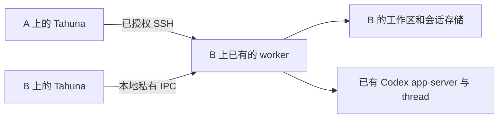

# 本地与远程访问同一设备的工作区

状态：用户已最终确认需求。A 控制 B 时，B 安装 Tahuna 后应看到与 A 所见完全相同的 B 工作区。B 只显示本机和它主动连接的设备，不自动看到 A 或继承 A 的其他设备连接。此前的逻辑组网与跨设备目录复制方案撤销，不进入实施范围。

## 同一份数据，两条访问路径

B worker 是 B 工作区的唯一权威来源。A 远程访问、B 本地访问读取同一 WorkspaceID、名称、主目录、附加目录、Git 默认及关联的 session 数据。已接受的修改由同一个 worker 保存并发布，两端接入同一 revision 后数据一致；不维护两套可独立修改的工作区数据库。

B 安装客户端后复用同一 OS 用户下已有的 worker、DeviceID 和数据目录，不因本机／远端两条路径创建重复工作区，不重置既有任务，也不因打开会话重复启动 agent。A 下线不影响 B 读取自身数据。跨 OS 用户访问不由这项需求自动授权。

## 设备列表独立

| 客户端 | 可见范围 |
| --- | --- |
| A | 本机 A，以及 A 主动连接的 B、C 等设备 |
| B 刚安装 Tahuna | 本机 B 的工作区和会话 |
| B 主动连接 A 后 | 增加获授权访问的 A 工作区；不自动导入 A 的其他连接 |

连接列表和凭据由各客户端独立管理。A→B 不建立 B→A 的连接，不上传 A 的连接列表，也不要求 B 能拨号到 A。B worker 的工作区枚举接口只返回 B 自己的数据，不能返回 A 客户端聚合出的所有设备目录。

客户端仍可保存正常显示与重连所需的缓存，但不在 worker 间复制其他设备的目录。断线时标明数据为上次已知状态；不能把陈旧缓存冒充当前一致的执行状态。

## 状态和并发建议

| 数据 | 建议处理 |
| --- | --- |
| B 工作区定义、目录／Git 默认、会话索引 | B worker 权威保存 |
| 历史、计划、变更、活动状态、待审批／问题、已接受队列 | 从同一 B worker／harness 读取，按稳定 ID 和事件 revision 更新 |
| 未发送消息、问题答案草稿、阅读位置、折叠和布局 | 各客户端独立，避免覆盖正在编辑的内容 |
| SSH 连接、私钥、Tailnet 节点身份 | 各自安全存储，不随工作区交换 |

除工作区数据一致和设备可见范围外，表中的具体共享范围与并发规则仍是实现建议。数据一致不要求两端选中同一会话、滚动到同一位置或共享未发送草稿。

worker 负责排序、接受确认与变更发布。客户端修改工作区／队列时带预期 revision；过期修改返回冲突。审批／问题只能对仍有效的 request 提交；一端解决后另一端收到相同结果，不再次发给 app-server。新 turn、steer、中断和分支操作都在 owning worker 校验当前状态，不以 UI 缓存决定是否有效。

## 验收

- A 在 B 创建／重命名工作区，修改主目录、附加目录和 Git 默认，B 本地取得相同 ID 与已接受值；B 的修改也可由 A 读取。
- B 安装或升级应用时复用原 worker 和状态；A 离线后 B 自身工作区仍完整可用，不重复启动会话。
- 同时查看同一会话时，两端接收同一有序内容和生命周期；审批、问题和队列操作不重复执行。
- B 未连接 A 时不显示 A 的工作区或 A 连接的 C；B 主动连接 A 后显示 A，C 仍需 B 自己建立连接。
- 断线后保留草稿、明确缓存新鲜度，重连以快照和更高序号事件收敛，不重放未确认操作。

## 补充验证记录

2026-11-03 在 Air 上运行临时 Go／SQLite owner：A 使用控制 Mac 上的 SSH 字节客户端，B 使用 Air 本地进程访问同一个私有 Unix socket。没有安装两份 Tahuna GUI，没有访问 A 的 worker，也没有实现跨 OS 用户授权。[完整记录](research/macos-2026-11-03/multi-client-air.json)。

- A 创建后，B 首次本地接入获得完全相同的 snapshot、DeviceID、WorkspaceID、目录、Git 默认和 session context；B 后续修改可由 A 读取。A 每次 SSH 请求都结束，不维持持有数据的控制进程。
- 同一 revision 的两个并发修改只有一个接受，另一个返回冲突；同一操作重试返回原结果且不增加事件，不同 payload 复用同一操作 ID 被拒绝。
- 跳过事件后按 cursor 补齐得到连续序号；工作区主目录／Git 默认修改不会改变已接受的 session launch context。该 session 是存储夹具，不是另一个运行中的 agent。
- 另一 owner 不能重复占用同一状态；SIGKILL 后 launchd 重启，ID、工作区、context、已接受队列和事件游标保持。队列从不执行，因此本项不能证明运行接受的 exactly-once。
- schema 1→2 后保留上述数据；旧 binary 明确拒绝 schema 2，新 binary 可重新打开。这不是正式安装／升级／回退流程。
- 独立的真实 Codex app-server 夹具中，两个客户端同时回答同一问题、同时拒绝同一审批，均只有一个实际 response 和一个 `serverRequest/resolved`，另一端收到已失效。待请求期间其他 thread 可完成。没有用该结果声称 app-server 崩溃后能恢复原请求。

设备枚举夹具仅返回自身 B，显式提交非 B owner 被拒绝；没有把 A 的连接表传给 B。B 主动连接 A／C 的产品流程、长期事件保留、断线 GUI 草稿和流式投影仍未实现。首次夹具检查还暴露 macOS `/tmp` 与 `/private/tmp` 的 canonical root 不一致，统一规范化后才通过路径检查。

这些实验支持单一权威 worker 与并发接受规则的可行性，正式功能尚未实现；冻结视觉稿保持不变。需要新增可见交互时再提出设计修订。
