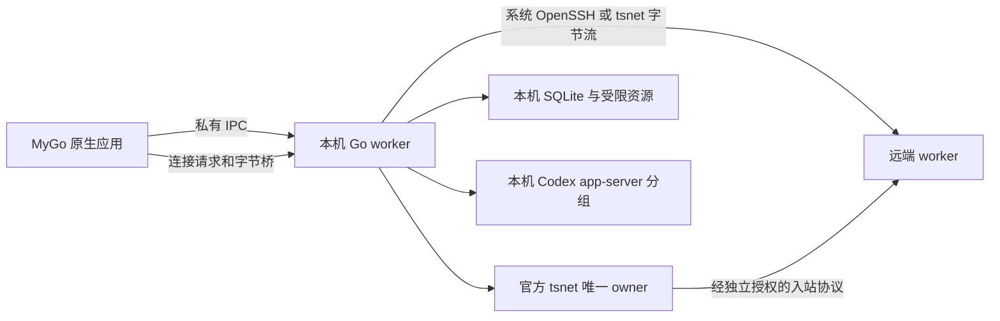

# Shioji 首期实施规格

2026-11-03。产品名已由用户确定为 Shioji（潮路／しおじ）；命令名使用 `shioji`／`shioji-worker`。本文文件名与历史材料链接保留原有 tahuna 命名，研究制品／签名身份不追溯更名。

2026-11-03。将冻结交互与实测结论转成 Go／MyGo、macOS Apple Silicon 的实现基线。本轮授权是编写规格；尚未开始产品代码实现。已确认的产品要求沿用 AGENTS.md，本文明确标注的“实施默认”是本次选定的工程方案，不冒充用户逐项批准。

## 1 交付范围与依据

首期让个人开发者用原生应用同时管理本机与远程 Mac 的多个 Codex 会话。任务属于工作区、工作区属于唯一设备；运行独立于窗口与 SSH 连接。A 连接 B 后，B 安装应用看到 B 原有同一份工作区和会话；B 不继承 A 的设备列表。

| 材料 | 实施约束 |
| --- | --- |
| [AGENTS.md](../../../AGENTS.md) | 最新用户要求；本轮新增动画“流畅自然、有迹可循” |
| [冻结基线](../../design-freeze.md)、[交互规格](../../../design/spec.html)、[主稿](../../../design/prototype.html)、[当前截图](../../../design/screenshots/current-v37/) | 原生实现几何、导航和交互依据；不修改 design/，历史候选不自动视为选定 |
| [中间模型](../../agent-model.md) | 本文落实其 ID、内容、能力与请求生命周期；Codex wire 类型留在 adapter |
| [同设备多客户端](../../multi-client-workspaces.md) | 单一 owning worker／数据，不做跨 worker catalog 同步 |
| [调研收尾](../../research-closeout-2026-11-03.md)、[实机验收](../../live-acceptance-2026-11-03.md)、[正式签名验收](../../signed-acceptance-2026-11-03.md) | 依赖、故障与平台证据；探针不直接作为生产 worker |
| [固定协议](../../../design/protocol/codex-0.166.0/inventory.json)、[逐项路由](../../research/macos-2026-11-03/codex-routes.json) | 首个 adapter 契约，非全部功能已启用的声明 |

不包含 Intel、Linux／Windows、第二个 agent adapter、账号云同步、自动继承设备连接、通用端口转发、任意 HTML／WebView 内容执行或动态插件平台。herdr-core 不进入依赖、制品、安装流程。公证等待不阻塞规格和本地实现；当前研究包的后台公证状态见 [等待记录](../../research/signed-acceptance-2026-11-03/notary-watcher.json)。

## 2 实施默认

| 项目 | 本次工程选择 | 发布边界 |
| --- | --- | --- |
| 构建 | Go 1.27.3、MyGo v0.7.4、tsnet v1.104.0、modernc.org/sqlite v1.61.1；锁定 go.mod／go.sum 与上游补丁 | 这些为已研究版本，不声称最新；升级需契约回归 |
| 平台 | darwin/arm64；构建 deployment target 13.0 | macOS 最低支持版本仍未获产品决定；13 是工具链技术下限，实机只验过 27.2，不宣传 13+ 已获支持 |
| worker | 同一 macOS 用户一个 worker，一个本地 SQLite writer；网络 owner 在该 worker 内 | 其他 OS 用户不因安装或加入 tailnet 自动获权 |
| Codex | 按兼容运行配置分组的 app-server 进程；一个分组可承载多个 thread | 分组故障会影响其全部 thread；不承诺进程崩溃后恢复原活动 turn |
| 多客户端 | 权威数据共享；未发送草稿、阅读位置、布局按客户端独立保存 | 用户未要求草稿或布局同步 |
| 安装 | 同一正式签名 runtime bundle 用于 SSH 先装 worker和本地应用后续接入；SMAppService.agent | 用户已登录 Aqua 会话；注销后持续运行不在首期承诺内 |
| 网络 | Direct SSH；tsnet Dial 后承载 OpenSSH；另设受授权 worker 入站 listener | tailnet 不自动授予执行权限，不自动开启系统 Remote Login |

不为这些默认项新增视觉设计。涉及新可见行为且冻结稿无对应表达时，先列具体差异与原生实现选择，再修订设计基线。

## 3 进程与制品

主程序负责窗口、原生渲染、输入、可访问性和本地显示状态。worker 负责本机执行、共享数据、连接监督、tsnet、Keychain 和操作接受。跨设备内容在 worker 中转时始终保留 owning DeviceID；本机 worker 不把远端资源落为本机权威工作区。

制品由 Shioji.app 与固定位置的 Shioji Runtime.app 构成。Runtime.app 是不自动打开窗口的后台宿主 bundle，包含独立 Go worker 和最小 ServiceManagement 平台桥。GUI 和 SSH bootstrap 调用同一宿主完成服务注册；远端安装 GUI 时先发现既有宿主并复用。二者不共享可直接读取的私钥，仅 worker／网络 owner 读取自己的条目。

实施默认 bundle identifiers：`dev.shioji.app`、`dev.shioji.runtime`、`dev.shioji.runtime.worker`。发布前允许一次统一调整，首个可保存用户数据的正式版本后保持稳定。每个独立 executable 分别构建、分别签名，具有不同 Mach-O UUID；不得直接复制主程序充当另一个身份的 helper。

worker 首先获得私有目录内文件锁，再绑定 socket、打开数据库。第二个 owner 明确退出，不删除活跃 socket、不生成另一 DeviceID。GUI 退出只断开 UI；关闭 Tailnet 或停止执行服务是独立显式操作。停止服务前展示活动会话／pending 操作，确认有序停止；不把“退出应用”映射成远端任务中断。

app-server runtime key 为 `(HarnessID, executable digest, negotiated protocol contract, Codex config directory/profile identity)`。仅会影响进程启动的设置参与分组；每 thread／turn 的 model、effort、Fast、权限与协作模式走确认的 wire 参数。每组初始最多 4 个活动 turn，设备总计最多 8 个，超出保留为持久队列；属于可配置工程预算，不是 Codex 本身的能力上限。stdin/stdout 专用 JSON RPC pipe，stderr 进入脱敏、有界诊断。

## 4 存储和身份

本机 worker 的私有目录为 `~/Library/Application Support/Shioji/worker/`，0700；数据库、状态和 socket 0600。runtime bundle 位于 `~/Library/Application Support/Shioji/Runtime/Shioji Runtime.app`，服务在该用户登录域运行。首次创建 DeviceID 为随机 UUIDv4，写入数据库事务；地址、SSH alias、node IP 变化不改变 DeviceID。

SQLite 开启外键、WAL、`synchronous=FULL`，单 writer；macOS driver 可用时启用 fullfsync 并查询确认，不静默假设成功。所有权威变更、operation 状态、journal 与投影在同一事务提交。先提交再给客户端 accepted；只读查询由有界连接池处理。数据库位于本地磁盘，不放工作区、Git 仓库或网络盘。

| 表／键 | 保存内容与约束 |
| --- | --- |
| metadata singleton | DeviceID、schema／journal schema version、数据库 generation、创建时间 |
| workspaces WorkspaceID | owner DeviceID、名称、revision、显式 primary FolderID、Git 默认、归档状态 |
| folders FolderID | DeviceID、规范化设备路径与显示路径；workspace_folders 关联，不把相同 repo 推成共享 Git 历史 |
| sessions SessionID | WorkspaceID、固定 HarnessID、source thread ref、状态及 LaunchContext JSON version |
| runtime_instances InstanceID | runtime key、进程启动标识、退出／连接状态；PID 不作为持久身份 |
| turns TurnID | SessionID、source turn ref、活动／终态、确认时间与 per-turn usage 字段 |
| items ItemID | SessionID／TurnID、稳定 order key、内容类型、revision、最终内容／资源引用 |
| requests RequestKey | instance、typed source ID、body version、生命周期、source item、结果回执；不保存 secret 答案 |
| operations OperationID | principal、目标、类型、payload digest、接受／派发／确认状态、幂等结果 |
| queue QueueItemID | SessionID、排序、accepted input、配置快照、状态、关联 OperationID |
| journal Generation + Sequence | 设备单调序号、事件类型、实体 revision、可恢复 payload、提交时间 |
| resources ResourceID | DeviceID、会话 scope、类型、长度／digest、私有文件引用和保留策略 |
| peer_grants GrantID | Tailnet peer StableNodeID、应用公钥指纹、权限、吊销状态；不随工作区交换 |

客户机显示数据库单独位于 `~/Library/Application Support/Shioji/client/`：主动连接表、最新缓存 cursor、普通草稿、per-session 配置、pager、布局和阅读位置。默认草稿持续保存但不上传其他客户端；secret 表单仅在当前进程内存存在，退出后要求重填。连接凭据只放本机 Keychain。缓存携带 owner／采样时间／连接 epoch，不伪装成当前运行证据。

目录设置保留“曾移除的主目录”及显式替代，重新添加不会悄悄升为主目录。已有 session 的 LaunchContext 永久保存实际接纳 cwd、additional roots、仓库／worktree、权限和配置；以后 workspace 修改不改写它。

## 5 worker 协议

实施默认协议为私有可靠双向 byte stream 上的长度前缀 UTF-8 JSON：4 字节 big-endian 长度，单帧上限 1 MiB；资源按 64 KiB chunk 单独流式传输。stdout 只能承载协议，日志不混入；本地 Unix socket、SSH stdio bridge、Tailnet listener 最终接入同一协议服务。

握手 `Hello` 交换 protocol major/minor、客户端版本、支持的功能和随机 nonce；worker 回 `Welcome` 包含 DeviceID、principal、数据库 generation、能力、连接 epoch 与实例版本。major 不兼容直接拒绝，minor 新字段允许忽略，但未知命令不猜测执行。客户端必须确认目标 DeviceID；SSH 已信任主机仍可能指向错误的用户／设备目录，发生变化要求重新绑定。

| frame | 必要字段 |
| --- | --- |
| Command | connection epoch、OperationID、DeviceID、目标 ID、命令类型、expectedRevision、typed body |
| Receipt | OperationID、accepted／rejected／indeterminate、结果引用、生效 context／配置或错误 |
| Query／QueryResult | request ID、目标与分页；不触发模型或执行副作用 |
| Snapshot | generation、atSequence、实体 revision、scope、权威投影 |
| EventBatch | generation、first／last sequence、带实体 revision 的有序事件 |
| Ack | generation、已应用 sequence；用于流控与保留，不作为外部副作用确认 |
| ResourceChunk | ResourceID、offset、长度、digest、scope |
| Error | code、可重试性、相关 OperationID、可读原因、受限诊断引用 |

初始命令集合：workspace create/update/archive、session submit/archive、turn enqueue/steer/interrupt、queue edit/reorder/remove/dispatch-confirm、request respond、Git query/checkout/worktree-create、resource read、peer grant/revoke、device readiness。命令不能通过传入自由 shell 字符串实现任意 RPC；Git／文件 API 各有 typed 参数及 owner 检查。

同一 principal／DeviceID／OperationID 重试且 payload digest 相同，返回原结果；同 ID 不同 payload 拒绝。workspace、队列、Git 操作带 expectedRevision；过期返回冲突和当前 revision。订阅先在 writer 屏障取得 snapshot 的 sequence S，再送严格大于 S 的 journal；分页快照必须固定同一 S，不混合多个时刻的数据。

客户端只在 generation 匹配时推进 cursor，重复事件去重，出现缺口停投影并补齐。游标已裁剪或 generation 改变时重取一致 snapshot；不偷偷跳过。每连接最多 2 MiB 未确认事件、10 秒无 Ack 断开后恢复，不阻塞 harness stdout；资源流独立限额。

## 6 操作接受和恢复

操作状态为 `accepted → dispatched → confirmed`，旁路为 rejected／indeterminate。accepted 表示 worker 可靠接纳操作；confirmed 表示相应外部动作已有证据，二者不能混用。发送消息的 delivery 独立为 queued／dispatching／sent／failed／unknown。

新会话提交：校验非空且非 IME 组合、连接／runtime／目录可用 → 在事务中保存操作与 provisional session、用户输入和 context → adapter 创建 thread 并发首轮 → 有权威 turn 接纳证据后发布会话可执行状态。worker accepted 仅确认可靠接纳，首页仍保留草稿并防止重复提交；首轮已被 harness 接纳、相应记录 confirmed 后，才清首页草稿并聚焦新 session。首轮明确失败保持可编辑草稿；确认不明可查看 provisional session，但不显示为已经运行。确认不明保留 operation 和 provisional session 用于核对，不自动删除或重复发首轮。

worker 在写入 dispatched 后才向 harness 发请求。进程在“已发送，未落确认”窗口死亡时标记 indeterminate；查询 source history、关联 ID 后能确认才落结果，不能靠无条件重试补救。不承诺 exactly-once 外部副作用。

| 故障 | 必须表现 |
| --- | --- |
| GUI／SSH 断开，worker 和 harness 存活 | 任务继续；重连 snapshot＋journal，pending request 可继续回答；不重发 prompt |
| app-server 崩溃 | 关闭该 instance 的响应入口，pending 表单失效；保留已提交内容，按历史核对 turn；明确 interrupted／unknown，不能把旧 running 当当前状态 |
| worker 崩溃 | 新 owner 读取 journal／operations，旧进程不可证明归属时不盲发新 turn；先核实或显式终止孤儿，再建立新 instance |
| SQLite FULL／READONLY／损坏 | 不确认新写操作；保留故障副本，进入只读诊断／显式恢复，不删库重建 |
| 服务被禁用或 Keychain 锁定 | 展示对应 readiness，保留草稿和队列，提供系统设置／解锁后的重试，不降级明文 |

首期不跨 worker 重启接管既有 app-server pipe。worker 为每组创建独立进程组，写启动记录；退出时有序停止，异常遗留进程须核对 PID 启动时间和运行记录，不凭 PID 或宽泛 pkill 清理。没有安全归属证据时阻止该组恢复并显示人工处理动作。

queue 只在相应 session idle、connected、无阻塞 request、harness 状态已核实后派发；同一 session 单一派发者。普通 confirmed turn/completed 可以推进下一条。Stop、故障、重启或重连使自动派发暂停；恢复确认与用户显式继续后才推进，不排空、不删除队列。steer 仅走真实支持的 steer，不通过中断重开伪装。interrupt 的 receipt 不等于 turn 已停止。

## 7 Codex adapter 和中间结构

adapter 独占该 runtime instance 的 app-server dispatcher，初始化协商后读取实际 model catalog、collaboration modes、permission profiles 和 managed requirements。首期固定 0.166.0 作为实现／测试基线；远端版本超出已测试契约时 readiness 为 incompatible，提供安装受支持版本的动作；不把任意 schema 差异当兼容。

wire structs 只存在 `internal/harness/codex/wire`。domain 使用带版本的 tagged union，保留有界 UnknownContent 和不透明 SourceRef；UI 不解析 Codex JSON 或终端文本。必须提供以下领域值：

| 中间值 | 必要字段／规则 |
| --- | --- |
| ContentItem | ItemID、SessionID、TurnID、固定顺序、revision、kind、typed blocks、final flag、SourceRef |
| ToolActivity | item／call ID、工具种类、输入／输出资源、生命周期、可空 exit code、真实失败原因 |
| PendingRequest | RequestKey、instance、source item、阻塞性、body、状态、revision；QuestionSet／ExecutionApproval／PermissionGrant／ExternalInteraction 分开 |
| CapabilitySet | supported／unsupported／unknown、来源 runtime／catalog revision，model、effort、service tier、mode、permission、steer／interrupt |
| UsageObservation | latestRequest／turn／session scope、可空 input/output/cachedInput、source turn、counter epoch 与基线完整性 |
| TurnTiming | 已确认起止／duration、可区分的等待区间、当前本地 observed clock，不将缺失值当 0 |

source request ID 在 adapter 中保留类型；`0`、`"0"` 和不存在各不相同。RequestKey 使用随机不透明 UUID 与 `(InstanceID, typed wire ID)` 映射，不暴露可猜测的 wire ID 为授权依据。

原始事件先经 adapter 正规化，worker 在事务里更新投影和 journal，客户端 reducer 确定性消费。最终 item/completed payload 权威覆盖已有增量；重复 final、不合次序的 late delta 不另起消息。structured plan 仅来自 turn/plan/updated；普通 prose／plan item 不填结构化步骤栏。工具组由有序事件派生，后续非空 assistant prose 才自动折叠前组一次；保留用户显式展开选择。

所有冻结 ThreadItem／server request／notification 必须对应路由表里的实现、内部处理或明确不支持，不要求把 115 类都变成可见卡片。未知 item 显示安全、受限可读兜底；未知 request 回明确错误，决不默认允许。client tool/call 只执行已经注册的 typed 宿主能力；缺 provider 的 attestation、realtime、remote control 等不协商成支持。

回答流程：worker 校验 principal、request revision、instance、状态和完整 typed 答案，在单一调度器保留响应权，再发一次 wire response；另一个客户端得到冲突／已解决。pending→submitting 不代表 answered；以实际 response／serverRequest/resolved 和相关权威证据确认。先 resolved 的表单失效，已确认的回答回执不能被迟到 resolved 清空；没有回答证据时只显示已结束。secret 答案只在内存过渡，不进普通 items/journal/operations；其幂等摘要使用 worker 私有 Keychain 密钥做 HMAC，不保存可离线猜测的明文摘要。

普通 tool/requestUserInput 不猜测 multiple 字段；MCP elicitation 按 pinned schema 支持数组／枚举、数值、布尔、secret、object 等真实类型。超出首期表单子集时显示明确受限状态，不默默把复杂 schema 当文本回答。async agentMessage questions 不伪造 JSON RPC response；缺经验证的专用回答路径时保留可读内容和能力限制。

Read only／Default／Auto Approve／YOLO 使用已研究的 sandbox／approvalPolicy 映射，再应用实际 managed restrictions。Auto Approve 保留 sandbox，YOLO 才是无 sandbox。模型切换重新正规化 effort/Fast，Plan 只作用下一次提交。已有 session 的 harness 固定；配置修改不解决 pending request、不改写活动 turn。

## 8 SSH Tailnet 和授权

Direct SSH 使用系统 OpenSSH 的用户认证与主机校验；首次／变更 host key 通过独立来源核对，绝不 `StrictHostKeyChecking=no`。保留用户 SSH config，不静默覆盖 ProxyJump／ProxyCommand；冲突在连接设置中显式提示，只有用户选择 Shioji 嵌入桥的连接才设置对应 ProxyCommand。私钥留 Keychain／系统 agent，终端密码不进入应用日志或配置。

Tailnet 出站 SSH 使用 worker-owned tsnet.Dial 经私有 byte proxy 到目标已有 sshd；proxy stdout 只传字节，保留二进制与 half-close，绑定原始目标／端口和当前连接 epoch，禁止通用网络代理。不得用普通系统 socket 假装已走 tsnet；不得把系统／Herdr 的节点身份当作应用自己的身份。

实施默认的首次配对入口仍为经用户认证的 SSH：通过已信任主机执行 bootstrap／连接 worker，确认 DeviceID，交换控制端应用公钥、目标 worker TLS 公钥和双方当前 Tailnet StableNodeID；将此次用户主动添加的连接登记为本 OS 用户的执行授权。用于 bootstrap 的地址可能属于系统或其他应用的节点，它不是 B 的 Shioji 节点身份；双方 StableNodeID 必须来自各自 Shioji owner 并经 SSH 权威查询。B 的 Shioji 节点未授权时保持 tailnetNotReady，使用受限、仅内存登录入口由用户授权后才建立 Tailnet grant，不把 bootstrap peer 的 StableNodeID 代填。之后允许通过 tsnet 原生 worker 通道接入。首次目标没有 SSH 且没有已有 grant 时明确要求准备 SSH；不在首期另建远端批准、配对码、云中继或自动信任全 tailnet 的流程。

原生 worker listener 使用 `tsnet.Listen` 固定 TCP 端口 24170。连接接受后先 WhoIs 取得真实 peer identity，再进行 TLS 1.3 双向认证：各设备独立应用密钥，证书信任根／公钥 pin 由前述 SSH 通道取得；校验 TLS 身份、目标 DeviceID、peer StableNodeID 与未吊销 grant 的绑定。TLS 证书校验失败直接关闭，不能靠关闭验证绕过。握手 nonce 与连接 epoch 用于 freshness，worker 的业务授权仍逐命令检查。首期 grant 是同一 macOS 用户的 Shioji 执行控制权；不是任意 OS 用户访问权，也不向 peer 暴露通用文件系统或 localhost 端口。

TLS／tsnet 私钥和状态加密 master 仅 worker 读取；encrypted StateStore 以独立随机 nonce、认证加密、临时文件＋fsync＋rename 保存，目录 fsync／macOS 同步语义由故障测试验证。缺 key、认证失败或状态损坏时 fail closed，保留故障副本，不自动生成新节点覆盖旧身份。正常退出关闭 server，不 Logout；用户注销 Tailnet 才 Logout。GUI、system Tailscale 和 Shioji 节点身份互不混用。

入站与出站共用同一个网络 owner，不随窗口退出而停掉。关闭 Tailnet 会断开其相关连接，明确展示远端任务可能继续运行；Direct SSH 与本地会话按各自状态工作。禁用／吊销 grant 后拒绝新连接并关闭对应现有控制通道，不向 harness 伪造停止。

设备 rows 仅显示近期 peer RTT，未知为未知；详情从实际 peer observation 区分 direct／DERP／peer relay／unknown。DERP 名称／code 从实际中继观测取得；不从 home region 推断，不用本机→DERP 延迟替代 peer RTT。默认可见设备每 15 秒测一次，详情 5 秒，后台 60 秒；样本 30 秒后标记过期，离线保留 last-known。peer 发现遵守 netmap 可见性与策略，不索取 admin API token。

## 9 文件 Git 与工作区一致性

所有 path 为 `(DeviceID, device path)`；验证、读取、Git、worktree 在 owning worker 上完成。worker 文件服务用 os.Root 和 canonical 路径约束资源 scope，拒绝父目录逃逸和外逃 symlink。该 scope 不等于 agent OS sandbox；agent 可访问范围须由 adapter 实际接受的 roots／permission 明确回传。

workspace create/update 必须验证主目录存在、附加目录在该设备可读。普通非 Git 目录同样可创建工作区并启动会话：LaunchContext 的 repository／worktree／branch 字段为空，Git 状态标记 notApplicable，分支和新建 worktree 控件不适用；不因缺 Git 阻止普通任务。检测到 Git 仓库时才验证实际 repository 与 Git 默认；额外目录不是共享 Git 历史。切换主仓库重置首页分支为该 repo 可用默认，已有 session cwd 不迁移。Git 操作按 canonical git-common-dir 串行锁。worker 同时维护每个实际 checkout/worktree 的 session 占用索引；分支切换／复用目录的首轮提交在同一 repo 锁内原子复核。切换方必须 idle、连接可用、无 pending request；同一实际 checkout 下任何其他 session 仍 running、pending、已保留派发权或外部动作 indeterminate 时，拒绝 checkout 并指出占用会话。不同 worktree 不因共享 git-common-dir 被错误视为同一 checkout，但 Git 元数据修改仍串行。还须在设备端确认 dirty/conflict 及 checkout 结果。

用户已确认非 worktree 切分支规则：分支是实际目录的共享状态。切换会话／打开历史仅导航，不触发 checkout；首页选择分支只是保存草稿意图，发送时才在 owning worker 验证和执行需要的切换。对已有会话，只有用户显式切换才发 checkout 操作。

首期实际改变分支时要求 index 和工作目录干净，包括没有未跟踪文件；存在改动就返回需先处理的原因。这个限制不应用于普通同分支发消息，否则 agent 将无法继续处理自己产生的未提交改动。不自动 stash、force checkout、reset 或丢弃改动。并行使用不同分支时，提供等待占用会话结束或用户显式新建 worktree 的选择，不自动把已有会话迁到另一个目录。

显式成功的分支切换为发起 session 追加 execution-context revision，保留原 LaunchContext 和历史，不重写其他 session。共享目录的其他 idle session 若已接纳分支与实际 checkout 不符，显示 contextChanged，暂停该 session 的队列／首轮派发；用户通过既有分支选择确认实际上下文后才接受下一轮，不能静默更改分支或目录。首页为已有 checkout 选择不同分支也经过同一占用检查，不能绕过活动 agent 保护。worktree 创建失败回滚可证明的自有部分，不强行清理用户目录。

A 与 B 本地接入 B worker 取得相同 WorkspaceID、名称、目录、Git 默认、session、pending 请求及 accepted queue；写操作按 worker revision 收敛。B 枚举只返回自身权威数据，不接受 A 转发的设备目录或连接凭据。客户端可各自选择会话／阅读位置，不使另一端跳转或覆盖草稿。

变更视图区分单 turn patch 与设备当前 working tree；文件数量与 diff stats 由实际受支持数据计算，未知值不伪造。资源读取校验 principal／session／DeviceID／长度，不把远端路径交给 UI 本机文件 API。

worker 的 checkout 锁只约束 Shioji 调度的操作。仓库 watcher 用于及时发现变化，每次接受下一轮／派发队列前仍在锁内重读实际 HEAD、分支、checkout 身份和相关状态；不能仅靠 watcher 缓存。终端或 agent 自行切分支时标记 contextChanged、保留原上下文并暂停后续队列，用户确认后才能继续下一轮。已运行的工具可能已经观察到外部修改，不宣称能阻止外部 Git，不自动切回或伪造中断成功。

## 10 MyGo 原生呈现与动画

按冻结稿逐屏映射 MyGo 组件：工作区侧栏、全页首页 composer、原生 Markdown／代码／diff、底部审批／问题 pager、Plan／Changes inspector、设备 collection/detail、设置与菜单。优先 toolkit 原生组件和已有系统 API；组件能力不足时在 native selection／平台接口补足，不引入 WebView 替代主内容。

正文虚拟列表每列有明确 FillHeight 约束；可见 ItemID 和 rune offset 维护逻辑选择，支持跨卸载端点的选择／复制。须扩展固定 MyGo 的 selection 接口；不以常驻整段历史或仅替换 clipboard callback 规避。应用保留最小上游补丁，并以单栏／双栏流式选择回归约束版本升级。

输入、配置、问题草稿按稳定 session/request/question ID 保存。Enter／Shift+Enter／Cmd+Enter、IME、防空提交与离线 guard 均在提交前校验；普通 composer 不被问题表单替换。pager 新到请求不抢焦点、不切页、不强迫滚动。滚动只在原本 following latest 时跟随；dock 高度变化保留阅读锚点和完整 scrollbar gutter。tick rail、工具组折叠和 turn footer 按真实事件派生。

**动画必须流畅自然、有迹可循。** 过渡表达同一内容在位置、层级、展开程度或状态上的连续变化；用户能看清来源与去向。此要求不新增冻结稿外的装饰、布局或品牌元素。实施默认如下：

| 场景 | 默认行为 | 验收 |
| --- | --- | --- |
| 菜单／popover | 100～140 ms 的轻微 opacity／位移，跟随触发器，打开即响应键盘 | 不漂移、不遮挡 gutter、不等待动画才可操作 |
| pager／queue 展开收起 | 140～180 ms 高度与 opacity 协调，composer 保持可见 | 不抢焦点，阅读锚点稳定；快速反向操作从当前进度连续反转 |
| inspector／双栏切换 | 160～220 ms 空间连续，稳定 pane 与 item identity | 不重建内容、不丢选择，窄布局只使用原有 drawer |
| 消息流与状态 | 合并增量直接更新对应 item；少量状态过渡可淡入 | 不逐 token 做入场、整段淡出重现或每次 delta 滚动动画 |
| waiting／running／completed | 真实生命周期立即可读；状态形状和语义颜色按冻结约束 | 无脉冲、glow 或伪进度；动画结束不作为操作完成证据 |

动画采用一个共享 native motion adapter，初始统一 ease-out，无弹跳 overshoot；时间是工程初值，实际调优以冻结几何和实机观察为准。尊重系统 Reduce Motion：去掉空间位移／尺寸补间，保留即时状态或不超过 80 ms 的简单淡化。动画不阻塞事件接受、键盘和可访问性；可中断、可取消，取消后状态与真实投影一致。60 Hz 下以 16.7 ms 帧预算为优化目标，在 120 Hz 设备采样而非假定满帧；正式 SLO 待产品负载测量，不能用 RPC 往返时间充当绘制帧时间。

## 11 资源预算和诊断

普通 stream 增量按最多每 16～33 ms 一次合并，单次只更新受影响可见项；writer 按最多 25 ms／50 条普通增量批量提交，operation 接纳、请求状态、queue／workspace 变更即时事务提交。每次 wire 接收、stream 组装与资源读取均设长度限额：app-server 单条输入上限 16 MiB，超限进入明确受限错误而不截断 JSON 后继续；大资源改为引用和分页。

journal 初始预算每设备 256 MiB 增量记录，先持久化一致 snapshot 并保留未解决操作／请求需要的证据，再裁剪已归档增量。历史最终内容与 journal 分开；不因 journal 裁剪删除用户会话。缓存／大资源默认上限 2 GiB，优先驱逐可重取缓存，用户内容和不可重取输出达到预算时提示管理，不静默删除。诊断默认 50 MiB 轮转、7 天，先按 wire 类型移除 token、私钥、登录 URL 和 secret，再落盘；原始 payload 默认不收集。

所有错误有 code、owner、operation 与可确认程度。错误按钮只执行已说明的恢复操作；retry 不能重新发未知是否执行过的 prompt／工具／队列。导出诊断前提供预览与脱敏，不把凭据或原始秘密答案放进资源包。

## 12 安装 升级 与签名

SSH bootstrap 先检查 OS／arm64、目标用户／GUI 登录域、已有 Shioji DeviceID／schema／服务版本、可用磁盘和 Codex readiness。只上传带签名和 digest manifest 的自有 runtime bundle，验证 Developer ID／Team 与期望版本，再在私有 staging 中原子安装；不修改系统 sshd、Tailscale、shell rc 或 Homebrew Codex。

本地应用发现已由 SSH 安装的固定 Runtime.app：兼容时直接接入；版本不同而有活动任务时提示延后更新。首期拒绝带活动 turn／未确认外部副作用的自动 worker 升级。队列可保留但先暂停派发；数据库一致备份、签名／schema 预检、停止旧服务、替换固定 bundle、重新注册、新 worker 验证 DeviceID／schema／socket 后接回 UI，失败返回明确恢复状态。

SMAppService 的 notRegistered、enabled、requiresApproval、notFound 分开展示；后台项目需用户允许时提供系统入口，API register 成功不冒充可运行。远端无法交互解锁 Keychain 时标为 credentialUnavailable，不能把密码传给脚本或改成明文。

数据库迁移在独占 worker、无派发时进行，写 schema version 与 migration state。失败保留可恢复备份；仅当数据库仍与旧 binary 兼容时允许回退，已完成新 schema 后旧 binary 必须拒绝。初次 B GUI 安装不迁走数据库、不创建重复 worker，也不自动重启现有任务。

首期 Codex 默认探测已有、兼容的用户安装；缺失时用户显式安装到 Shioji 管理的版本目录并完成 Codex 认证。下载源、digest、签名与第三方分发许可需在实现时验证，未完成前不静默下载、重签或随应用捆绑第三方 Codex。运行 readiness 独立于 SSH／Tailnet 连通，缺账号／模型能力保持 setup 状态。

发布流水线按内层 executable／bundle 到外层 app 签名，使用稳定 Team／identifier、Hardened Runtime、安全时间戳、最小 entitlements；检查各独立二进制 UUID。最终分发制品提交 Apple 公证并附票据，重新校验 signature／Gatekeeper。notary 凭据仅本机 Keychain 或受控 CI secret，不进入仓库或命令历史。无 sudo 作为正常产品安装前提。

## 13 代码边界

实施时建立单个 Go module，初始目录职责如下；这是待建目录，不表示代码已经存在。

| 目录 | 职责 |
| --- | --- |
| cmd/shioji | MyGo 应用入口 |
| cmd/shioji-worker | worker／私有 bridge 子命令入口 |
| internal/domain | 稳定 IDs、typed content／requests／capabilities，不依赖 UI、Codex wire 或 transport |
| internal/protocol | worker frames、版本、长度／scope 校验与客户端 |
| internal/worker | owner、operation dispatcher、runtime 分组、queue、recovery |
| internal/store | SQLite schema、事务、snapshot／journal、备份／迁移 |
| internal/harness/codex | app-server 生命周期、协商、wire dispatcher、adapter |
| internal/transport | SSH、tsnet owner、私有字节桥、TLS／grant、连接观测 |
| internal/devicefs、internal/git | owning-device 文件／Git 服务与 repo 锁 |
| internal/app | 客户端视图模型、草稿、选择、投影 reducer、显示缓存 |
| internal/ui、internal/platform/macos | MyGo 组件、motion、selection 扩展和最小系统桥 |
| packaging、tests/fixtures | bundle／签名脚本和脱敏、schema 校验过的契约数据 |

依赖方向是 UI→app/domain/protocol，worker→domain/store/adapter/device services；adapter→domain 和私有 wire。研究 scripts 留在 research，不被产品入口 import，也不携带个人机器地址／用户名进入默认配置。

## 14 分阶段交付与验收

每阶段提供可运行原生制品、相应故障／集成测试和限制记录。研究探针 PASS 不直接抵扣产品测试。具体任务拆分由实施者在这些边界内完成，不建立另一份相互漂移的长期计划。

| 阶段 | 可验收结果 | 进入下一阶段条件 |
| --- | --- | --- |
| 1 本机闭环 | 本地 worker／SQLite；原生工作区、非空首页提交；真实 Codex 流、基本工具与审批／问题、持久历史和 reconnect | GUI 关闭不停止活动会话；两个 session 同时运行不串上下文；首轮拒绝不丢草稿；wire／schema 与真实账号集成各有证据 |
| 2 并发与恢复 | queue／steer／interrupt、完整 pinned 类型路由、pending pager、Git/worktree、history hydration、逻辑选择、资源预算 | crash／FULL／冲突与 unknown 处理通过；不重放副作用，流式／双栏与动画实机回归通过 |
| 3 SSH 和同设备多客户端 | worker bootstrap、严格 host key、远程资源、A SSH 与 B 本地 GUI 同接一个 worker | DeviceID/workspaces/session/queue 一致；双端回答仅一个 wire response；B 不继承 A/C 连接；安装 GUI 不打断既有兼容 worker |
| 4 嵌入 Tailnet | 官方节点、安全持久身份、SSH bridge、已配对 worker 入站、RTT／path、断线重连 | 无系统客户端可双向；未授权 peer 拒绝；节点／grant／凭据恢复正确；UI 不把 unknown 显示为 0 或猜测 relay |
| 5 分发验收 | 签名／公证、Air Gatekeeper、服务授权／升级、隐私与 Keychain、兼容矩阵和文档 | 最低支持系统明确且有实机证据；电源／锁屏／用户禁用后台服务及迁移回退场景完成或明确不作支持承诺 |

测试矩阵必须包括：

- 确定性 reducer：delta→final、重复／迟到事件、snapshot 屏障、generation 变化、cursor 缺口、usage 缺字段与 cached 子集。
- 真实 pinned app-server：并发 thread、不同权限／模型、pending 跨断线、两端回答竞争、resolved 竞态、Stop／steer／queue、进程中途死亡；fixture provider 与真实模型服务结果分开记录。
- 存储：accepted 与外部发送之间的每个崩溃点、迁移 SIGKILL、FULL／READONLY／BUSY、损坏副本、备份与旧 binary 拒绝；不宣称模拟断电等于物理断电。
- Git：非 Git 工作区正常提交；会话导航不 checkout，首页选择只存意图；同 checkout 的其他活动／pending／派发预留／不确定 session 阻止首页和已有会话切分支；dirty index／工作目录／untracked 阻止实际切分支，但允许同分支普通提交；不同 worktree 独立；contextChanged 不自动派发；外部 Git 变化被检测且不会自动切回。
- 传输：严格 host key 错误／变更、DeviceID 不匹配、旧 epoch、私有 socket 权限、TLS pin／peer binding／吊销、断流／半关闭、慢客户端与资源超限。
- 原生界面：真实中文候选窗、发送键设置、选择跨虚拟卸载、双栏流与 dock 高度变化、键盘／焦点、Reduce Motion、快速中断动画；VoiceOver 当前用户跳过，保留语义和后续验收项。
- macOS：同 Team 正式升级、不同／缺失 key、加密状态篡改 fail closed、Local Network allow／deny、SMAppService 状态变化、锁屏／休眠／重启，按用户允许的时段执行电源操作。

## 15 实施时仍需守住的决定边界

本规格已给出可开始实现的默认值；生产入站配对采用“先经 SSH 建立信任”的边界，默认预算、runtime 分组、共享与客户端状态范围均按本文执行并测试。用户仍保有最低 macOS 支持版本、正式应用 identifiers／分发形态与后续新增可见流程的最终决定权；发布前必须明确，不能靠技术下限或研究夹具替代。

公证后台结果只影响现有研究包的分发证据，不自动让未来新构建的产品获得公证。正式产品必须重新走完整签名／公证和相应验收。

## 16 规格审阅

独立 builder check 的两个阻塞问题已落实到 §9：跨会话 checkout 占用的原子校验，以及非 Git 工作区的完整可运行语义。原生动画要求已写入 AGENTS.md；具体动效参数仍是实施默认，不改写冻结设计。

2026-11-03 用户随后确认 §9 的分支切换策略：共享目录级保护、导航不切分支、首页提交时再校验、切换要求干净、禁止自动 stash／强制覆盖、其他会话显式确认新上下文，并检测外部 Git 变化。此策略现在是已确认要求，不再只是工程默认。
