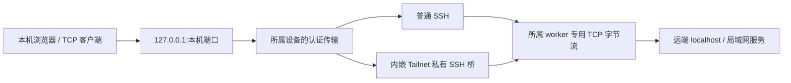

# 全局侧栏与端口转发

已批准的功能与交互设计，2026-11-15 开始原生实现。

## 已确定的需求

- 用户要求：独立区域展示当前端口转发，可手动创建，也可直接关闭。用户进一步明确端口转发是全局功能，不适合放在会话右侧栏。
- 用户要求：远程设备会话中的 localhost 或局域网 IP URL，右键菜单提供「端口转发并打开」。
- 用户要求：从 URL 创建时优先使用本机相同端口，创建成功后自动打开。
- 用户要求：普通 SSH 与 Shioji 内嵌 Tailnet 连接的远程设备均支持转发。
- 用户要求：左下固定区改为设备、Tailnet、端口转发三个默认只显示图标的入口；hover 显示名称，图标名称展开和面板滑入滑出均需动画。
- 用户要求：点击入口向上滑出小侧栏，设备展示全部已添加设备的状态、连接方式与延迟；独立按钮进入设备页并关闭小侧栏。Tailnet 展示节点状态、名称和全部可见对端（含离线），独立按钮进入 Tailnet 配置页。

## 使用流程与侧栏

沿用现有冷色灰阶、系统字体、侧栏内缩卡片和菜单密度。功能面向在不同 Mac 上并行开发的人，重点是从远端开发服务快速打开本机浏览器。视觉保持紧凑、安静、明确；信息重点集中在本机端口和对应设备，不增加品牌图形或装饰。

侧栏端口转发交互稿。这是浏览器交互示意，正式界面全部使用 Go / MyGo 原生控件。

- 用户修订：端口转发不再常驻占用左侧导航高度，移入左下全局快捷面板。固定工具栏上沿分隔线横贯侧栏、贴到左右内框，不留滚动内容可穿过的缺口；侧栏底部与既有外框闭合。三个入口依次为设备、Tailnet、端口转发，设置入口保留最右侧。用户追加修订：固定底栏从 44 DIP 收紧到 34 DIP，28 DIP 点击区域上下各约 3 DIP 留白，图标大小与横向间距保持不变。
- 我的布局建议：三个入口共用一个与左侧栏同宽的紧凑面板，覆盖会话列表底部而不推移列表或改变其滚动位置；面板下缘紧贴固定工具栏分隔线，不使用悬浮小卡片和额外外框。用户修订：各面板按真实内容定高，不保留统一固定高度或多余空白；用户补充：设置明确最大高度，当前设计值为 360 DIP（含 40 DIP 标题，不含 34 DIP 固定底栏）；同时不得超过侧栏内高减去底栏 34 DIP 与顶部保留空间 40 DIP。内容较少仍按实际内容收缩。超出后仅列表内部滚动，标题保持固定；Tailnet 的本机摘要与「对端」组标题也固定，只滚动对端。首页、会话和设备页均可使用，不挂在任何工作区内。
- URL 快捷操作成功后，打开左下端口转发面板并定位新增或复用的映射，不切换会话、不影响右侧栏的打开状态、文件选择与阅读状态。关闭快捷面板、隐藏导航、切换页面都不关闭转发。
- 每项两行：首行「3000 → localhost:3000」，次行设备名。每行文字保留省略与完整悬停信息；行高约 44 DIP，首行 12 / 18，次行 11 / 16。已有故障时次行显示设备名与简短状态，详情放悬停。右侧保留 28 DIP 关闭按钮；标题加号同样使用公共命中区域。
- 点击项打开保存的本机访问地址；右键提供打开、复制本机地址、复制目标地址、故障时重试和关闭。关闭立即取消建立中或存活的连接，等待监听及流释放后移除该项，不确认、不影响远端服务与 agent。
- 手动创建使用紧凑原生弹窗：设备、目标地址、目标端口、本机端口。设备默认当前工作区的远程设备，允许选择其他已添加远程设备；目标地址默认 localhost；本机端口默认跟随目标端口。手动填写的本机端口必须原样取得，占用则原位提示，不静默换号。取消保留已有转发，不产生新项。
- 手动创建按钮用「创建」，成功关闭弹窗并显示新项；不自动打开浏览器。手动项的点击 / 打开默认使用 http 根路径，菜单另保留复制纯地址，支持其他 TCP 客户端使用。
- 远程会话内对符合条件的已完成链接右键显示「端口转发并打开」。用户消息、回复和可链接的工具输出使用同一入口。右键定位实际链接，不依赖整段文本或当前选中文本推断。普通左键行为保留。
- 会话右键操作固定来源设备，双会话视图也按被点击链接所在会话决定；即使之后切换工作区也不得转到新设备。不因为出现 URL 自动创建转发。

## 设备与 Tailnet 快捷面板

- 设备面板展示本机与当前客户端明确添加的全部远程设备，包括离线设备；不继承其他客户端连接列表。用户最新修订：恢复设备与 Tailnet 对端的上下两行信息展示，但在线状态保持 4 DIP 绿点 / 灰点，不恢复设备图标和重复在线 / 离线文字。设备首行显示状态点、名称与右对齐 RTT，次行显示连接方式；Tailnet 对端首行状态点、名称与右对齐 RTT，次行显示完整 IP。行高恢复 48 DIP；状态点对齐首行，次行文字与名称共用左边界。按当前活动 route 显示 SSH / Tailnet，不因设备同时保存多条路由而误报。名称过长单行省略，悬停提供完整值；状态保留可访问名称与悬停信息。
- 用户修订：跳转入口统一放在小面板顶部标题旁，用 28 DIP 命中区、10 DIP 向右上箭头图标进入对应页面；设备面板的箭头进入已有设备页，去掉底部管理按钮和列表内重复的详情箭头。点击时关闭面板并导航，不修改当前会话、连接、权限或草稿。打开概览、点击设备行或展开列表不隐式连接离线设备。
- 本机延迟不适用；离线、未测得和过期样本与当前 RTT 区分，不显示为 0。当前样本用 12 ms 一类格式，未知用「—」，过期样本若保留必须明确标为上次测量；细节在悬停中展示。可见状态更新仅来自已有设备控制器和测量，不从 UI 发起循环探测。
- Tailnet 展示 Shioji 内嵌节点的真实状态（已连接、已暂停、未连接、授权中、错误）、当前实际节点名称，以及全部当前可见对端（含在线和离线）。以用户最新要求「Tailnet 对端列全部设备」替换之前仅在线的选择，仍仅限内嵌节点实际可见范围，不是管理 API 中不可见的全网节点。列表标为「对端」，以 Snapshot.Peers 的 Online 决定绿点 / 灰点，不将在线描述成已有 SSH 或执行权限。本机节点作为顶部两行摘要展示：首行状态点、12 DIP 节点名与右侧 11 DIP 灰色「本机」，次行 11 DIP Tailnet 地址并与名称左对齐。去掉额外「本机节点」小标题，摘要共 48 DIP，与对端使用相同字号；无外框和底部分隔线，下接「对端」组标题。设备与对端行之间去掉横线，保留面板顶部和固定底栏的封口线。
- Tailnet 对端恢复两行展示，状态点、名称与右对齐 RTT 第一行，IP 第二行并与名称左对齐；不恢复图标、在线 / 离线文字或单行末尾 IP 的布局。用户补充：在线对端也展示最近一次端到端 RTT，使用内嵌节点已有 Measurement，不使用到 DERP 的延迟代替对端 RTT；离线、未测得或样本过期时显示「—」，不展示为当前数值。概览不额外增加路径说明，长名称与极长地址单行省略，悬停显示完整值。无对端、节点未运行、名称缺失或状态读取失败分别显示真实的短空态。标题旁的向右上箭头进入现有设备管理内的 Tailnet 配置页并关闭面板，不再保留底部管理按钮；打开或收起面板不授权、加入、暂停或退出网络，不调用系统 Tailscale CLI。

## Tailnet 未连接与异常状态

我的建议：未连接时保留已知节点名称并用灰点，次行显示「未连接 Tailnet」，不显示旧地址或将旧对端列表当成当前数据。尚未加入、尚无节点时摘要名称显示「尚无节点」，次行「未加入 Tailnet」。暂停、授权中与连接失败分别显示「Tailnet 已暂停」「等待浏览器授权」「Tailnet 连接失败」，不统一写成离线。标题旁的向右上箭头始终可进入配置页，不在小面板中自动重连、授权或增加重复操作按钮。网络恢复后才显示当前地址与权威对端列表，面板高度同步过渡。

交互稿顶部提供 Tailnet 演示状态选择器与「更多设备」开关，仅切换模拟画面，用较长的设备 / 对端列表检查 360 DIP 上限和内部滚动，不改变真实网络。正常在线 / 离线设备依旧只用绿点 / 灰点；异常文字说明网络节点的具体状态，不逐条重复设备状态。

## 固定工具栏与动画

- 我的动效建议：底部三个入口固定 28 DIP 命中区、16 DIP 图形槽，默认名称隐藏。鼠标悬停或键盘可见焦点时，名称以图标上方的紧凑提示标签显示，180 ms EaseOut 裁切并上移 4 DIP；离开时反向收回。三个图标及设置入口的位置、命中范围始终不变，避免名称展开推移相邻按钮而导致点偏。文字不换行，点击后的选中态只用中性灰，不强制常显名称。对应面板展开时隐藏该入口的名称提示，避免提示持续遮住最后一行设备信息；面板标题已标明当前类别。
- 面板以固定工具栏上沿为裁切边界，260 ms EaseOut 从下向上滑入，关闭时反向向下滑出，不用整块淡入淡出。固定分隔线、底栏图标和设置始终不移动。动画进行期间点击同一入口可连续反向，不先跳到起点或终点。
- 仅在面板已展开时，切换三个入口保留同一外壳，完整标题、内容和标题动作按设备 → Tailnet → 端口转发顺序整体横向滑动，260 ms EaseOut；外壳的实际高度同步从当前实测高度过渡到目标内容高度，由一个外层负责高度动画。快速切换承接当前位移与高度，旧页退场期间不可交互。列表增删、状态或对端数量变化也更新内容高度；各列表滚动位置与端口创建草稿独立保留。
- 用户验收修正：关闭后打开另一个面板时，先在不可见阶段直接就位目标页与目标高度，再只播放向上滑入；不得残留从上一次类别向新类别的左右切换或先出现旧内容。再次点击当前入口、点击面板收起按钮、按 Escape 或点击侧栏外部可收起；展开状态内切换不短暂关闭再打开。键盘关闭后焦点回到来源按钮；图标提供完整可访问名称与展开态。面板内的原生输入、IME 与滚动保留，不因 hover 或动画抢焦点。
- 减少动态效果时立即切换并保持同一最终几何与焦点。界面动效不改变节点生命周期、设备连接或端口转发所有权；进入配置页立即导航并同时收起，不以延迟回调触发可能过期的导航。

## 地址、端口与打开

| 输入 | 默认行为（我的建议） |
| --- | --- |
| HTTP / HTTPS URL | 支持 localhost（大小写忽略及尾部点归一）、IPv4 / IPv6 回环、RFC1918 私网、IPv6 ULA，以及 Tailnet 的 100.64.0.0/10 地址。0.0.0.0 / [::] 开发服务地址分别转换为所属远端设备的 127.0.0.1 / ::1。其他公网地址保留普通链接操作。 |
| 端口 | 有效范围 1–65535；HTTP / HTTPS 未写端口时分别取 80 / 443。URL 快捷创建先尝试本机同端口，仅在占用或无权绑定时由系统分配空闲端口；其他错误明确失败。申请监听与保留端口一次完成，不先查空闲再占用。 |
| 手动目标 | 允许用户明确输入有效主机名或 IP 和 TCP 端口，由目标设备解析、连接；拒绝控制字符、URL、无效端口和缺少 scope 的链路本地 IPv6。首版不做端口扫描或服务发现。 |
| 同一目标重复操作 | 以稳定 DeviceID + 规范化目标 host + 目标 port 判断复用，不跨设备复用。URL 操作复用已存在或正在创建的映射；显式手动选择其他本机端口可另建映射。失败项重试成功前不打开。 |
| 浏览器地址 | 本机仅监听 127.0.0.1，打开时仅替换 host / port 为 127.0.0.1:实际端口；原有 scheme、path、query、fragment 保留。带 userinfo 的 URL 不提供快捷操作。完整 URL 不写入日志或持久化。 |
| 已复用映射 | 本次点击的路径决定本次打开地址；更新该项内存中的最后访问地址供侧栏再打开。复用不创建第二条映射。创建中的多个明确打开请求按各自 URL 完成，取消后不得迟到打开。 |

「成功」必须有本机监听成功、所属设备身份确认，以及从远端侧成功建立目标 TCP 连接的证据；仅启动 SSH 进程或绑定本机端口不算成功。检查只建立 TCP，不发送额外 HTTP 请求。成功后才调用系统浏览器；打开浏览器失败保留转发并显示可重试的错误。HTTPS 证书、Host / Origin 校验、重定向与页面内部绝对 URL 保持原样，不改写响应、不绕过证书错误、不自动转发其他端口；WebSocket / HMR 通过透明 TCP 转发自然传递。此功能不承诺修复远端网页自身对本机地址的假设。

## 生命周期与连接

我的建议：转发归控制 Mac 当前应用进程所有，按稳定设备身份组织，不绑定可见会话或某个窗口。切换会话、折叠侧栏、关闭会话或关闭窗口不关闭转发；真正退出 App 时全部回收。首版不保存并自动重开转发，不把用户转发放进 Tailnet 网络后台服务或 agent worker 的持久任务队列。

普通 SSH 与 Tailnet 使用同一传输契约。为每个浏览器 TCP 连接建立一条专用、确认 DeviceID 的 worker 字节流：普通 SSH 经已授权 SSH 路径，Tailnet 经内嵌网络服务提供的私有 SSH 桥；远端 worker 从自己的网络环境拨号目标。每次新建流从该设备当前可用路径取得连接，不能缓存过期 Tailnet 桥。保留 SSH 主机验证，连接与凭证不从另一个客户端继承。

- 新增版本化的专用 TCP 流握手：沿用 worker 的认证和 DeviceID 核对，校验目标后拨号，成功回执后只传原始双向字节。独立连接承载字节流，不把流量塞进会话事件或普通 JSON RPC 消息；支持半关闭、有界缓冲与取消。旧 worker 不支持时明确提示更新，不能显示假成功，也不为了本功能自动停止活动会话升级。
- 设备 RPC / agent 断线不直接推断转发失效；根据自身连接 / 拨号结果显示「连接中」「可用」「无法连接」。新浏览器连接可重新通过该设备当前路径拨号；保留原本本机端口，不静默换设备或换端口。路径切换不承诺迁移现有 TCP 连接，受影响的浏览器需要重连。
- 远端不可达或服务停止时，已建立项目保留监听和本机端口，显示故障并允许重试 / 关闭；在新流成功后恢复可用，不自动重新打开浏览器。后台不轮询网页，不进行周期性 HTTP 健康检查。创建阶段失败则回收本次全部资源并保留输入 / 简短错误。
- 关闭转发、移除设备、退出 App 都取消对应建立任务、监听和所有客户端 / 远端流，等待自身 goroutine 与 SSH 子进程结束。移除单条设备路由后，下一条流遵循剩余已授权路由；移除设备则关闭该设备的全部映射。停止内嵌网络只影响依赖该路径的流，不关闭普通 SSH 转发，也不退出已有 Tailnet 身份。
- 关闭与异步创建使用稳定映射 ID 和 generation 防止迟到回执重建项目或打开浏览器。创建、探测、字节转发和清理全部离开 UI 线程；单映射连接数与拨号超时有明确上限。默认同时 32 条流、单次拨号 10 秒，由实施者在实测后调整并记录。

## 实施与验收

模块划分：transport 负责认证设备字节流与 TCP 转发；worker / protocol 负责版本化 TCP 打开握手及远端拨号；app 负责跨窗口映射注册表、去重、生命周期和更新；ui 负责侧栏、表单、URL 解析入口和成功后打开。MyGo 仅补通用的链接右键回调与命中信息，不能引入 Shioji 的设备语义。harness-neutral 合约与 Codex adapter 都不参与端口转发。

当前证据：现有 transport/loopback.go 提供专用于登录回调的 SSH 转发；app/TailnetSSH 已通过私有桥路由。此功能沿用其认证路径，但不能把登录回调的同端口限制、10 分钟授权超时或探测 URL 混入通用转发。现有 Markdown OnLink 只处理点击，需在 MyGo 文本 / Markdown 链接命中处增加右键入口。冻结设计验证已通过：6 个 repository-visible 文件与基线一致，冻结输入不直接修改。

1. 单元与集成检查覆盖 URL 分类（IPv4 / IPv6、默认端口、转义路径、query / fragment）、端口绑定冲突和拒绝权限、目标去重、设备隔离、创建 / 关闭竞态、浏览器调用只发生在成功后、远端失败与重试。
2. 真实 TCP 服务验证双向流、大响应、半关闭、多连接、取消与监听释放；覆盖常见 HTTP / WebSocket 开发预览。worker 专用流同时验证错误设备身份、旧版本及越界目标输入。关闭后本机端口必须可重新绑定，子进程与流数归零。
3. macOS 原生验证亮暗主题、窄窗口、空列表、列表滚动、手动创建、中文 IME、键盘与右键命中，双会话设备归属、切换会话后仍可访问、关闭项与快速反向操作。保留真实原生交互视频，不把 HTML 示意作为验收证据。
4. 分别用普通 SSH 和内嵌 Tailnet 连接的真实远程设备验收：远端仅回环监听的服务、远端可达局域网地址、相同端口优先及冲突回退、点击后打开原路径、服务停止 / 设备断线 / 恢复、关闭后释放。Tailnet 需在系统 Tailscale 客户端未运行时验证。若没有可用远端或权限，只报告已验证边界，不能声称已支持真实链路。

实施者自行决定：具体类型和文件名、原生图标复用、流握手的编码细节，以及不改变上述行为的布局微调。首版范围为 TCP 本地转发，不包括 UDP、反向转发、SOCKS、对局域网公开本机监听、后台常驻和自动识别启动服务。

设计记录：document/port-forwarding（本文件）与 html/port-forwarding（侧栏示意）位于 .ryugi/artifacts/，仅局域网预览且 auto-publish 关闭。用户批准后把最终规格保存到 docs/ryugi/specs/2026-11-15-port-forwarding-design.md，保留以上用户要求与工程建议的区分。

用户已批准设计并要求开始原生实现；保留现有图标字面度量与光学对齐，原生截图验收。
