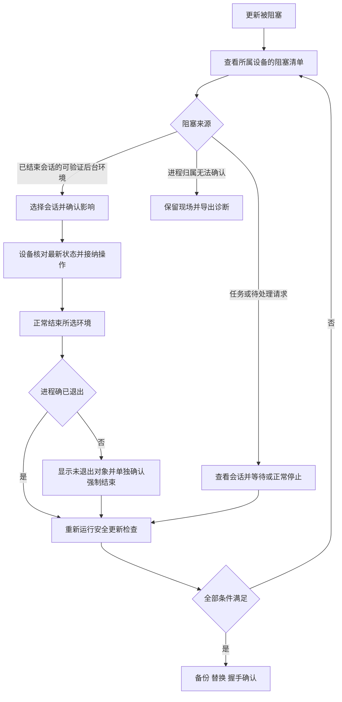

# Worker 更新受阻：人工处理流程

已于 2026-11-16 在对话中批准设计与画板并授权实施。

视觉依据：原仓库 `.ryugi/artifacts/artboard/worker-update-recovery/canvas.json`，主流程 entry / blockers / confirm / progress，异常 mixed / force / unknown，深色 dark-list / dark-confirm，窄窗口 narrow，可点击原型 prototype。

设计提案 · 2026-11-16 · 尚未实现。建议把设备页的“等待空闲”变成一个可检查、可明确处理的状态。常规路径是：查看阻塞 → 选择已结束会话的后台环境 → 确认结束 → 重新核对 → 安全更新。用户不需要查找 PID。

以下交互、范围及超时为本次设计建议；既有产品约束继续生效。这份文档记录处理流程与工程边界，对应视觉探索见下方画板；设计提案不修改冻结设计或当前程序。

## 为什么会一直等

这次本机和 119 的任务记录已经结束，但部分 Node REPL 保留了内核子进程。工具协议没有待完成请求，并不证明子进程没有后台工作；现有安全检查因此拒绝升级。退出 GUI 不会关闭设备 worker，等待也不会让常驻内核必然退出。

不能按进程名或总数判断异常。SSH 连接桥、执行守护进程和系统托管待命进程都可能叫 shioji-worker。只有经过归属核验、确实阻塞更新的运行环境进入处理清单；正常桥接与 Tailnet 不进入清单。

## 用户如何处理

### 1. 设备页查看原因

执行服务行显示“等待空闲”，右侧保留可点击的“查看阻塞”，不再只有一个禁用按钮。行下只显示简短的实际原因，例如“2 个已结束会话仍保留后台环境”。有正在执行的会话时显示“还有 1 个任务正在执行”。原因由设备返回，轮询不能把它覆盖为通用等待文案。

### 2. 按会话检查后台环境

打开所属设备的原生处理面板，顶部固定设备名称与地址。本机显示“此 Mac”。清单按工作区、会话归组，显示会话名称、真实执行状态、工具名称及阻塞原因。可以“查看会话”；进程数量、PID 和已脱敏命令放在可展开详情，普通用户无需理解进程树。

示例：“MacNativeGames · 调整窗口交互 / 会话已完成 / Node REPL 仍有 2 个常驻子进程，后台活动无法确认”。这里的“已完成”只指会话，不给后台进程加“安全”或“无任务”标签。

### 3. 选择要结束的会话环境

已结束且归属可验证的会话提供复选框，默认不选。选择单位是该会话的完整后台运行环境，包括 Agent 运行实例、工具服务及其受管后代；不让用户逐个猜测该杀哪个 PID。主操作为“结束所选环境并更新”，未选择时禁用；次操作为“继续等待”。

正在回复、等待授权或回答、输入投递不明的会话提供“查看会话”，不提供复选框。需要停止任务时，进入该会话使用已有停止或执行核对流程。其他正在运行的会话继续执行；即使选中的环境已结束，也必须等全部更新阻塞解除后才能升级。

### 4. 确认实际影响

确认框标题为“结束 2 个会话的后台环境并更新？”正文列出选中的会话，并说明：“这些会话的 Agent 和工具后台进程将结束。内存变量会丢失，后台任务会停止。已写入的文件不会回滚；会话历史、草稿和待发消息会保留。”操作为“取消”和“结束环境并更新”。只确认这一次，不提供“以后不再询问”。

确认不授权停止整个设备、其他会话、未知归属进程、其他应用或独立 Tailnet 服务。会话终态不因关闭运行环境改成失败或完成。

### 5. 结束、复核、更新

面板按真实阶段显示“正在结束所选环境”“重新核对执行状态”“备份并更新”“正在重新连接”。结束成功后再次执行原有安全更新准入，验证候选制品并保存包含 WAL 的一致备份，替换服务，最后通过新握手确认原设备与候选构建。

成功显示“执行服务已更新”，处理清单清空。会话可按原历史继续，但 REPL 内存不会恢复。队列保留暂停，更新结束后不自动重放或恢复派发。

## 同一个清单中的三类状态

| 状态 | 用户操作 | 设备约束 |
| --- | --- | --- |
| 任务仍在执行、待处理请求、投递或执行尚未确认 | 查看会话，继续等待；需要停止时走已有会话停止或核对流程 | 不能因等待时间长、低 CPU、会话在后台或窗口关闭而认定空闲 |
| 会话已结束，仍有可验证归属的常驻环境；可能存在后台工作 | 明确选择并结束该会话后台环境 | 停止范围固定在用户确认的设备、会话与运行代次，不能追到新的运行实例 |
| 归属记录缺失或冲突、PID 被复用、设备身份变化 | 查看详情、重新检查、导出脱敏诊断 | 不提供进程名批量结束，不允许强制确认绕过归属核验 |

运行环境刷新、Agent 登录和命名请求等真实阻塞也显示各自原因；只有能映射到上述后台环境的项目才出现结束入口。短暂阻塞继续按现有策略自动重试，不弹确认、不自动选择环境。

## 停止失败如何处理

先请求正常关闭，建议等待 5 秒。到期仍未退出时停在“部分后台进程未退出”，列出仍存活的对象及所属会话。只有再次核对归属和原运行代次通过后，才提供单独的“强制结束所选环境”确认。文案明确“这些进程将被立即终止，尚未写入的内容可能丢失”。首次确认不隐含强制结束授权。

强制结束仍只处理原授权范围。归属失效或新增无法归属的进程时停止处理，保留诊断；不能把按钮升级成“杀掉全部 shioji-worker”。强制结束后仍要证明进程退出，再核对更新条件，不把发送了信号当作已经退出。

若部分环境已关闭而其他环境失败，分别保留结果，不重启已经关闭的环境。已接纳操作在面板中提供“取消本次处理”；等待强制确认时也保留同一入口。取消在设备串行边界持久化，撤销本次自动更新意图，停止尚未开始的关闭或升级阶段，已发出的正常退出请求无法撤回。所选队列仍保留暂停，不能把取消当作恢复派发。多个客户端取得同一取消结果。

进入不可逆的执行服务替换接纳后，隐藏取消入口，提示“正在更新，请等待重新连接”；若取消与替换同时到达，以设备接纳顺序为准。仅关闭面板、退出 GUI 或断线都不等于取消。已经丢失的内存状态无法撤销。候选升级失败保留原服务可用状态或明确恢复状态，不回滚文件，不覆盖数据库。

## 操作范围与竞态

清单是预览，不是停止许可。任何关闭动作之前，先确认候选制品已经就绪并通过签名、摘要、协议和数据库兼容性预检；无可用候选时不结束环境。确认时由 owning worker 在维护与派发串行边界重新核对 DeviceID、会话与队列 revision、运行代次、待处理请求和进程身份。预览后若任一所选会话开始新任务、发生历史修改或换了运行实例，整次新停止操作不接纳，返回最新清单，要求重新选择确认。

接纳后持久化操作 ID 与准确目标，暂停所选会话的待发队列，并阻止这些会话在清理期间接纳新执行。客户端仍允许编辑草稿；发送时返回“正在结束运行环境，消息未发送”，不创建操作、不自动排队。其他会话照常运行。收尾进入现有全设备安全更新边界前重新核对全部阻塞，不能用关闭了两个会话来证明整个设备空闲。

若仍有其他活动会话，显示“所选环境已结束，等待其他任务结束后更新”。此时释放清理期间的发送限制，所选会话的队列保持暂停。用户可以主动继续该会话，但新的执行会继续延后设备更新。更新意图由设备持久化，GUI 关闭后仍可在真正安全时完成，不重复清理旧目标。

两个客户端处理同一设备时共享同一份操作和进度。重复点击返回既有回执；另一个冲突的操作返回进行中的操作。断线或回执未知后仅查询原操作，不能重发结束动作或输入。界面关闭不取消已接纳操作，也不能因重新打开面板再次确认同一操作。

## 工程边界

这是跨原生 UI、协议、worker、存储、进程管理及 adapter 生命周期的中等范围改动，预计涉及超过 8 个实现与测试文件，不新增常驻服务。保持 MyGo 原生界面，设备列表固定；处理面板沿用现有配置组件、灰阶密度与真实高度动画，支持减少动态效果。本提案不确认新的视觉几何。

- 新增中立的更新诊断与维护操作契约：结构化 blocker 类别、工作区和会话引用、运行环境名称、可执行动作，以及设备端不透明目标引用。PID 和命令属于展开的脱敏诊断，客户端不凭其发信号。
- 新增能力声明与四个版本化语义入口：读取更新阻塞、接纳或推进所选环境结束与更新、查询维护操作、取消维护操作。接纳与推进区分正常结束和再次授权的强制结束；每个有副作用的动作持久化独立幂等标识，并引用同一维护操作。重复、未知回执和取消均通过操作查询收敛。
- 操作记录保存设备与候选构建、确认的会话及运行代次、各目标结果、阶段、备份引用与错误。它必须跨 worker 替换读取，由新握手与原 DeviceID 完成最终确认；不能把连接断开标成成功。
- 持久更新意图由 worker 调度，使用现有空闲与派发串行边界；清理对象与更新阶段彼此分开。接口不得把正常结束、等待、进程状态未知和更新失败混成一个 busy 布尔值。
- 既有归属记录、进程身份检查与 adapter 协议可复用，但首次正常结束不能直接调用现有 Runtime.Close、Executor.Close、cleanManagedExecution 或 Scope.Stop：它们及关联取消／读取结束路径中存在自动强杀。必须在 adapter 到进程管理的完整链路增加显式的正常关闭模式，只请求协议关闭、关闭输入或发送正常终止信号；到期返回未退出对象，不隐含发送强制信号。请求正常退出也可能使进程丢失内存，已包含在首次确认中。
- 正常关闭、等待第二次确认、用户取消后仍有存活进程时，持续保留目标运行代次和进程归属记录。原 worker 异常退出后，新 worker 在普通受管清理之前先读取维护操作及目标的授权阶段；这些未获强制授权的存活目标只能重新核对并回到“等待处理”，不能落入现有恢复自动强杀路径。取消不抹除这份授权与存活记录。身份失效则只显示诊断，不跟随新 PID。
- worker 负责授权接纳、队列、幂等、进程身份及退出证明；adapter 负责关闭具体 harness。共享层不解析 MCP/Codex 的进程 ID 格式，也不按 Node REPL 名称授予停止能力。
- 正常 SSH 桥、执行守护与主 worker 分别分类展示，不能因同名或数量多进入异常清理清单。Tailnet、账号、设备权限及其他连接保持独立。

## 首版范围与旧 worker

首版处理“worker 可响应，但其受管会话后台环境阻塞更新”的情况。整个 worker 无响应、不可验证的旧 owner、无法归属的系统进程，不纳入这组按钮；继续使用对应的诊断或经过明确授权的设备恢复流程，不声称本方案能一键处理。

旧 worker 没有新维护能力时，只能显示它实际返回的原因及重试入口，不能通过客户端扫描进程伪造精确清理能力。首次安装此能力若被同类问题阻塞，沿用此次经过用户逐项授权、核对具体进程身份的人工恢复；不把本轮临时控制工具当成已支持的产品功能。正式签名恢复 helper 是独立范围，不在首版中暗含实现。

## 验收条件

1. 真实常驻工具创建内核子进程、协议空闲后，设备页能定位到所属会话；“会话已完成”与“后台工作无法确认”同时准确呈现。
2. 未确认、取消、关闭面板以及自动等待都不终止进程；正常桥接、守护进程与 Tailnet 不受影响。
3. 正常退出成功后，核对原进程及受管后代均退出，队列保持暂停、历史与草稿保留，实际新握手构建正确；继续会话沿原历史接续。
4. 真实忽略正常停止信号的进程在第一次操作后仍存活，必须第二次授权才允许强制结束；未写入的内存不能宣称可恢复。
5. 预览后新任务、队列变化、PID 复用、运行代次变化和归属丢失均拒绝过期停止；其他会话运行时清理可完成，但升级仍等待。
6. 两个客户端并发、SSH 断线、GUI 退出、旧进程晚到事件、更新回执丢失、替换失败后重连，均不重复发信号、不重发输入、不伪造完成。
7. 真实进程在等待强制确认及用户取消之后经历 worker 崩溃恢复，仍不能被 adapter 析构、context 取消或普通恢复清理偷偷强杀。验证取消与替换竞态、关闭面板不取消、取消后不自动升级且队列仍暂停。
8. 能力缺失的旧 worker 只呈现真实可用动作。原生亮暗模式、窄窗口、长会话名、键盘选择及减少动态效果均验证。

实施时运行相应 Go 单元、真实 macOS 进程集成、竞态与双客户端检查，以及 python3 scripts/verify-design-freeze.py --repository；测试使用隔离状态目录和本地确定性 provider。视觉修订另行评审，现有设计冻结输入保持不动。

## 本次建议的取舍

采用按会话结束完整后台环境，而不是让用户挑 PID；正常结束与强制结束分两次授权；已归属但后台活动未知的环境可以明确授权停止，未归属的进程不开放停止。这样覆盖本次故障，同时保持正在执行的任务和其他设备不被误伤。

不采用超时自动杀进程，也不增加默认的“强制重启整个设备服务”按钮。人工处理是明确结束所选运行环境，不是豁免安全更新检查。
