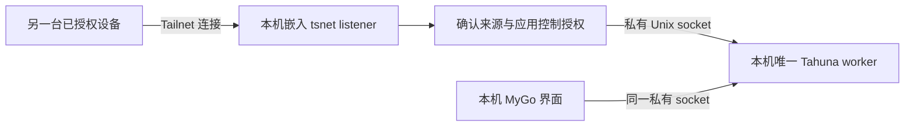

# 内嵌 Tailnet 入站连接验证

最新状态：用户随后恢复实机验证，真实 Tailnet 双向链路、严格主机校验 SSH、direct／DERP、持久节点恢复、GUI Keychain 与物理中文候选窗已通过；VoiceOver 跳过，Air 电源测试仍延期。见 [实机补充验收](live-acceptance-2026-11-03.md)。下文保留早期实验的当时范围。
2026-11-03。用户要求 Tahuna 加入 tailnet 后也能被其他设备连接，并指定参考相邻的 herdr-gpui。这里只读检查了该仓库；Tahuna 继续采用官方 `tailscale.com/tsnet`，未引入其 fork 或 herdr-core。设计稿保持冻结。

## herdr-gpui 的实际做法

检查版本为 `eb43fa2b4eb38e1965f3999653a5604bb2f63b5e`，相关文件无未提交修改。来源摘要与哈希见 [记录](research/macos-2026-11-03/herdr-inbound-sources.json)。

| 环节 | 源码行为 | 对 Tahuna 的意义 |
| --- | --- | --- |
| 网络库 | `github.com/sagernet/tailscale`，通过 `Server.NetstackHandler` 接入自有 handler | 此扩展不是官方 tsnet 的同名公开接口，不能直接照搬 |
| 入站 | 仅接受目标为嵌入节点自身 IP 的流量；IPv4 转 `127.0.0.1`，IPv6 转 `::1`，保留目的端口 | 加入 userspace 网络与启动本地服务是两件事；无需安装系统 Tailscale |
| 转发 | TCP 保留半关闭；UDP 保留数据报边界；共享上限 64 个流，UDP 空闲 2 分钟释放 | 值得参考的是边界、流控和清理，不只是 `io.Copy` |
| 生命周期 | disconnect、sign out、engine close 时主动关闭客户端和 backend | 不能只关闭 listener 而遗留已接受的连接 |
| 出站 SSH | 私有 IPC → 嵌入节点 Dial；OpenSSH 经 ProxyCommand 使用该字节流 | 可以保留系统 SSH 的主机校验，同时避免依赖系统路由 |
| 桥接约束 | peer/port allow-list、network/engine 标识、generation fencing；旧连接不回退系统网络 | 防止本地 bridge 变成任意目的地代理或误接另一个节点 |

主要文件：[说明](../../herdr-gpui/docs/tailscale.md)、[inbound.go](../../herdr-gpui/native/tailscale/inbound.go)、[engine.go](../../herdr-gpui/native/tailscale/engine.go)、[proxy.rs](../../herdr-gpui/crates/herdr-remote/src/tailscale/proxy.rs)、[tailnet.rs](../../herdr-gpui/crates/herdr-client/src/tailnet.rs)。没有运行、编译或修改该项目，也未安装它的组件。

其实现会让遵循节点访问策略的 peer 接触到本机回环服务；本地服务可能把回环来源视为可信。这个转发范围不自动成为 Tahuna 的产品决定。当前已确认的需求是其他设备能连入本机，通用 TCP/UDP 服务转发的范围仍需明确。

## 官方 tsnet 可以完成的路径

固定版本 `v1.104.0` 的公开接口包括 `Server.Listen("tcp", ":port")`、`ListenPacket` 和 `RegisterFallbackTCPHandler`。普通 `Listen` 只监听 tailnet，不会让系统自动拥有这个 IP。`ListenSSH` 是可选的嵌入 Tailscale SSH 服务，也不等于打开 macOS Remote Login。[官方固定版本源码](https://github.com/tailscale/tailscale/blob/v1.104.0/tsnet/tsnet.go)。

建议先提供显式的 Tahuna 入站端口：

网络 ACL、peer 身份、worker 控制授权分别校验；同属 tailnet 不自动获得执行权限。worker 协议不提供任意 shell RPC。SSH bootstrap 仍然有独立的主机验证、登录与部署条件，不能因为看到 peer 就认为它已可执行。

若需要经该节点访问系统 SSH，可另设显式的 TCP bridge 到已运行的本地 SSH 服务，保留 SSH 认证；没有启用 Remote Login 时应说明不可用，不擅自启用它。通用 UDP 转发不是当前 worker 控制协议的前提，本轮没有验证官方库的通用 UDP 转发。

节点身份只允许一个 owner。应用的出站 transport 与入站 listener 共用该 owner，不启动两个读写同一 identity 的 tsnet 实例。节点究竟由应用主进程还是随应用分发的 Go 后台组件托管，以及彻底退出应用后是否维持网络，尚待实施规格确定；worker 的运行与已接受任务仍必须独立于 GUI 和网络连接。

## 本轮受控实测

新增 [测试源](../scripts/research/tsnet_inbound_research_test.go)，在官方固定 checkout 的 `tsnet` 包内运行，复用上游本地 test-control/DERP。三个节点均为临时测试身份，没有加入用户真实 tailnet，没有调用系统 tailscale，也没有要求系统 SSH 服务。

- A→B、B→A 均通过嵌入节点建立连接，经各自 listener 转入私有 Unix backend。
- 包含 NUL、`0xff`、CR/LF 的字节完整往返；客户端 CloseWrite 后仍取得 backend 回复。
- 第三个未被夹具授权的节点被应用层拒绝，未进入 backend。身份检查使用本轮临时 node key；这不是最终持久 pairing 或凭据方案。
- 保留一条未发送完的连接后关闭 listener，并显式关闭已登记的两端流；handler 退出，远端读到关闭，未超时。

最终 `TestTahunaInboundOfficial` 通过，耗时 4.340 秒（包级）；[机器可读记录](research/macos-2026-11-03/tsnet-inbound.json)。这证明官方 API 的双向 TCP 和私有 socket 桥可行，尚未验证真实跨设备网络、用户 ACL、DERP/peer-relay 路径或生产认证。

初次夹具向已拒绝的连接发送 payload，服务端关闭未读数据导致客户端收到 TCP reset；后续改为授权拒绝检查先于 worker payload。该结果不表示第三个节点应被允许，也不把拒绝时必须收到可读提示当成协议保证。

真实 Tailnet 登录与 Air 链路按用户要求延期。正式签名、Keychain、Local Network 隐私提示、节点恢复和实际路径测量仍需后续验收。
