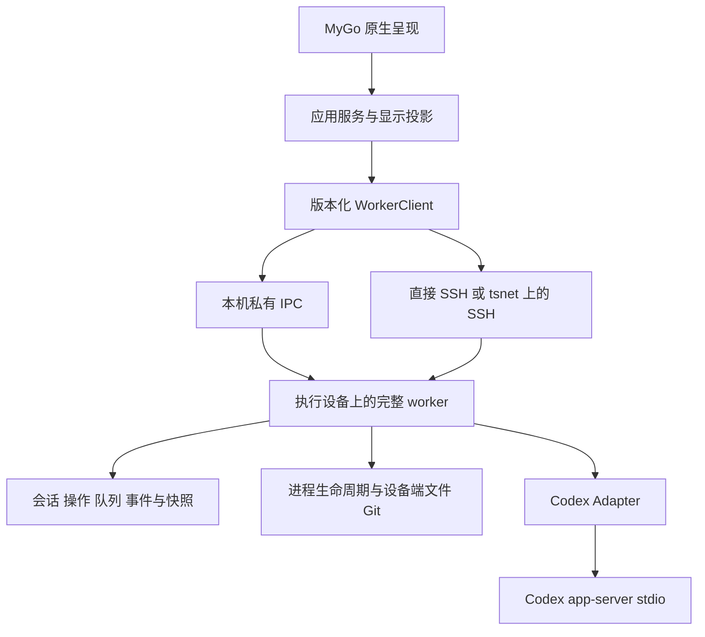

# Tahuna 原生应用技术调研

最新状态：用户随后恢复实机验证，真实 Tailnet 双向链路、严格主机校验 SSH、direct／DERP、持久节点恢复、GUI Keychain 与物理中文候选窗已通过；VoiceOver 跳过，Air 电源测试仍延期。见 [实机补充验收](live-acceptance-2026-11-03.md)。下文保留早期实验的当时范围。
2026-11-03。设计已冻结；本阶段完成源码核对、协议检查和技术建议，不开始产品实现。依赖候选与来源指纹见 [sources.lock.json](research/sources.lock.json)，验证范围见本文末尾。

第三轮补充调研已收尾，见 [最终报告](research-closeout-2026-11-03.md)。该报告汇总实测、已定位约束和用户明确延期的验收；早期记录保留其当时范围，不代表全部检查仍未执行。

后续用户已确认首期执行设备也仅支持 macOS。第二轮已加入 MacBook Air 的部署、后台进程、真实 app-server 断线问题恢复、纯 Go SQLite driver 与原生组件实验；最新结果和未通过项见 [macOS worker 技术验证](macos-worker-research-2026-11-03.md)。本文末尾的首轮记录保持其当时验证范围。

最终补充需求：A 远程访问与 B 本地访问必须取得 B worker 的同一份工作区数据；各客户端的设备连接列表独立，不做逻辑组网或 worker 间目录复制。具体边界见 [需求补充](multi-client-workspaces.md)。

## 已确定的方向与本轮建议

用户已确定：macOS 优先，Go + MyGo 原生 UI，尽量使用 MyGo 及系统现成组件；首期 Codex app-server；在 adapter 内转换成后续可接其他 agent 的中间结构。用户进一步确定采用自有完整设备端 worker，取消 herdr-core 运行时依赖，以减少目标设备的部署依赖。保留工作区与设备边界、内嵌 tsnet，以及冻结稿中的交互约束。

已确认的运行路径：自有 worker 直接管理 app-server，worker 内的 Codex adapter 产生版本化中间结构，客户端经本地 IPC 或 SSH 连接 worker。**完整 worker 与取消 herdr-core 已获用户确认；数据库、进程粒度、安装与服务托管机制、具体依赖版本和协议字段仍为建议，待验证。**

## 一、MyGo 的组件覆盖

MyGo `ui` 通过 GPU 绘制控件，macOS 后端使用 Metal；它不是给每个按钮和输入框创建一个 AppKit 控件。系统菜单、文件对话框、剪贴板、通知和凭据存储则可通过 MyGo 的系统 API 使用。两类能力可以在一个 Go 应用中组合，不需要 Swift 前端。[原生 UI](https://mygo.egoist.dev/docs/ui)、[架构](https://mygo.egoist.dev/docs/architecture)、[系统 API 源码](https://github.com/egoist/mygo/blob/v0.7.4/docs/native.md)。

| 冻结稿中的内容 | 优先复用 | 应用需要补足 |
| --- | --- | --- |
| 窗口、标题栏、全高左右分栏 | `mygo.NewWindow`、`ui.Split`、布局和工具栏控件 | 工具栏归属、最小宽度、布局持久化 |
| 工作区／会话／设备集合 | `ui.List`、稳定 key、搜索输入、基础行控件 | 分组折叠、注意状态、导航计数和 4 px 状态标识 |
| 会话正文 | `markdown.Stream`、结束后同位置 `markdown.View` | 按 item 持有内容、会话级缓存和原生引用胶囊 |
| 代码和工具输出 | Markdown 原生代码块、`ui/editor`、可选文本 | 输出限额、按需加载和工具组生命周期 |
| 改动阅读 | `editor.DiffView`、`DiffState`、统一／左右布局 | 在设备端取得真实 before/after；历史补丁与当前工作树分开 |
| 普通输入框 | `ui.TextArea`、`Lines`、`OnTextKey`、输入法支持 | 接受前保留草稿、快捷键配置、Queue／Steer／Stop |
| 文件／Skill 引用 | 原生布局、文字、图标与 tooltip | 引用解析和设备端定位，不套用浏览器标签 |
| 审批与提问 | Radio、Checkbox、TextInput、TextArea、Button、有界滚动 | 请求级表单校验、混合 pager、来源事件及原位回执 |
| 运行设置与权限 | `PopoverBase`／`PopoverMenuButton`、单选与开关 | 240 px 宽、名称／值列、选后保持打开、长名称换行 |
| 目录和附件选择 | MyGo 系统文件对话框 | 本机对话框只选本机文件；远端目录在 owning device 查询 |
| 全局菜单／文本右键菜单 | MyGo 系统菜单和编辑命令 | 使用标准 macOS 动作和焦点链 |
| 外部打开／通知／凭据 | MyGo 系统 API、`mygo.Secrets` | URL 验证、脱敏、按设备／账号命名空间 |

上表是组件映射，不表示默认外观已经符合冻结稿。菜单、selection、滚动条、表面和字体要通过 theme／base 控件适配，不能把默认系统强调色带入中性灰选中态。[控件列表](https://mygo.egoist.dev/docs/ui)、[菜单](https://github.com/egoist/mygo/blob/v0.7.4/docs/ui/context-menu.md)、[弹层](https://github.com/egoist/mygo/blob/v0.7.4/docs/ui/overlays.md)。

### 流式会话和长记录

MyGo 已提供增量 Markdown 解析、未闭合语法的流式展示、跨块选择，以及增量更新时保留选择；`ui.List` 支持稳定行标识和跟随底部。无需重新实现 Markdown 或把正文送入 WebView。[Markdown](https://github.com/egoist/mygo/blob/v0.7.4/docs/ui/markdown.md)、[列表](https://github.com/egoist/mygo/blob/v0.7.4/docs/ui/list.md)。

建议每个 session 保存投影索引，每个 item 保存独立内容缓冲，按稳定 item ID 构建可见行。历史分页，离屏工具输出只保留摘要，原文通过受限存储加载；媒体按设备端资源引用惰性读取。超大单条 Markdown 仍可能需要按块分段显示，虚拟化消息行本身不能限制一条巨型消息的构建成本。

网络和解析 goroutine 产出合并后的 patch，再用 `Window.Update` 在主线程发布状态。MyGo 每帧执行 view；其解析和布局缓存并不意味着应用可以每 token 重建全部历史。`ui.Element` 只在当前 build 有效；后台任务不能持有它，长期标识使用 `ui.Handle` 或应用 ID。[Views](https://github.com/egoist/mygo/blob/v0.7.4/docs/ui/views.md)、[性能测量范围](https://github.com/egoist/mygo/blob/v0.7.4/docs/ui/performance.md)。

会话 scrollport、底部 dock、双栏和 diff 同屏时的滚动跟随，需要单独做原生验收。MyGo 默认滚动条不能直接视为已满足冻结稿的透明轨道、稳定 gutter 与 idle fade。菜单也需要验证选后保持打开、hover 不抢键盘焦点，以及两侧放不下时的 Back 替换视图。

### 原生能力的边界

优先级：现成 MyGo 控件 → MyGo base 控件组合 → MyGo 已封装的系统 API。核对的源码没有建立可直接承诺的任意 AppKit 控件嵌入方案；不预设 `NSTextView` 能无成本插入 MyGo 布局。若中文输入或 VoiceOver 出现具体缺口，先验证 MyGo／上游补丁，再评估小范围平台桥接；不因此切换为 WebView，也不引入另一套前端。[输入接口](https://github.com/egoist/mygo/blob/v0.7.4/docs/ui/text-input-client.md)、[无障碍](https://github.com/egoist/mygo/blob/v0.7.4/docs/ui/accessibility.md)。

依赖候选为 MyGo `v0.7.4`，其 `go.mod` 要求 Go `1.27.3`。本机默认 Go 是 `1.26.7`；此次在源码目录通过自动工具链选择实际运行了 `go1.27.3`。产品工程仍须明确固定工具链，不能依赖开发机默认版本。MyGo 文档给出的原生窗口运行基线为 macOS 12，但用户已限定首期为 Apple Silicon macOS，不支持 Intel；产品最低系统版本与打包体积仍需联合 tsnet 和实际签名包验证。[go.mod](https://github.com/egoist/mygo/blob/v0.7.4/go.mod)、[环境要求](https://mygo.egoist.dev/docs)。

## 二、职责和依赖方向



建议目录边界：

```text
cmd/tahuna/                    macOS 应用入口
cmd/tahuna-worker/             本机与远端统一的 worker 入口
internal/presentation/         MyGo views、主题、原生控件组合
internal/app/                  客户端用例、显示投影、草稿、注意导航
internal/domain/               device/workspace/session 与中间模型
internal/transport/            local、ssh、tailnet、身份与重连
internal/worker/               进程、会话、操作、队列、恢复、文件与 Git
internal/worker/protocol/      版本化命令、事件、快照、能力与错误
internal/harness/codex/        worker 内部的 wire types、codec、请求与能力适配
internal/store/                客户端存储与 worker journal 的独立实现
```

客户端不直接依赖 `HarnessAdapter` 或 Codex wire package；它调用 WorkerClient。HarnessAdapter 是 worker 内部边界。worker 是用户已选择的执行运行时，本机执行也使用同一路径；它不改变 MyGo 前端和控制端内嵌 tsnet 的选择。目标设备不需要安装 herdr-core 或 Go 编译工具链；worker 首期制品只构建 `darwin/arm64`，最低 macOS 版本待验证。

`DeviceID` 不由 IP、SSH host 字符串或 tailnet 地址直接生成；同一设备可有多个 connection。工作区的全部 folder 必须属于同一设备。Session 接受创建时固定 execution context：主目录、附加目录、仓库身份、实际 worktree、harness 和权限配置。后来修改工作区只影响未来创建，不静默扩大已有会话的目录访问。

## 三、Codex app-server 接入

以本机 `codex-cli 0.166.0` 和精确导出 schema 为起点，同时检查当前官方文档。官方文档是滚动更新的，不能把今日文档中的所有字段默认视为所有远端版本可用。[官方 App Server](https://developers.openai.com/codex/app-server/)、[项目固定版本清单](../design/codex-session-protocol.md)。

### 消息通道

app-server 是双向 JSON RPC：客户端方法、服务端请求、通知三种方向都要处理；wire 上省略 `jsonrpc` 字段。stdio 是 JSONL；reader 持续解码，writer 串行写入，stderr 独立处理。不能使用默认 64 KiB 的 scanner 上限接收长补丁／内容，也不能只实现客户端请求响应而丢掉服务端请求。

每次新连接先 `initialize`，成功后 `initialized`。模型列表、权限限制、配置和实验开关来自 owning device 的运行环境；schema 的存在不代表能力已启用。能力值保留 supported／unsupported／unknown 和不可用原因，不从版本号推断全部功能。

### 操作与生命周期

| 应用意图 | Codex 映射 | 接受和完成依据 |
| --- | --- | --- |
| 创建会话 | `thread/start` 后 `turn/start` | 非空提交获接受后才建立可见会话并清除对应草稿 |
| 继续会话 | `thread/resume`，按该版能力读取历史 | 恢复 thread 不自动重发上次输入 |
| 普通发送 | 空闲时 `turn/start` | 匹配 RPC 结果和 turn ID；完成看 `turn/completed` |
| 加入队列 | worker 持久保存已接受队列，客户端维护镜像 | 不是提前发多次 `turn/start`；正常完成且条件允许才发下一条 |
| 立即介入 | `turn/steer` + `expectedTurnId` | 接受不等于模型已处理；不产生新的 `turn/started` |
| 停止当前轮 | `turn/interrupt` | RPC 成功只表示已请求；匹配 interrupted 生命周期才结束 |
| 执行审批 | 原 server request 的 typed response | 按 request 生命周期保存回执，不能发成普通聊天 |
| 回答问题 | 当前 request 的完整 answer set | 同请求一起提交，其他 pending request 独立 |

`turn/steer` 不接受 model、cwd、sandbox 等 turn-level override；运行设置用于下一个有效新 turn，不借 steer 修改活动轮。普通输入发出后若 harness 通过 `serverRequest/resolved` 清理问题，界面按实际事件使其失效；“普通输入框始终可用”不意味着 harness 保证所有问题永久待答。[Steer 与请求生命周期](https://developers.openai.com/codex/app-server/)。

`item/started` 创建或更新原 item，delta 追加至该 item，`item/completed` 的最终内容权威替换；不把 final 和 streaming 各绘一遍。结构化计划来自 `turn/plan/updated`；变更集合来自对应 item／聚合 diff，不能累计两份。协议完整映射见 [中间模型](agent-model.md)。

### 模型、权限与用量

- 读取 `model/list` 的具体默认模型、effort 和 service tier，结合实际配置／账户能力决定 Fast 可用性；Fast 不能用低 effort 模拟。Plan 模式是 collaboration mode，侧栏 plan 是结构化展示，两者独立。
- 四种 Permission 名称保持冻结稿语义。映射前读取配置和 managed requirements；Read only 不等于只关闭审批，Auto Approve 保持 sandbox，YOLO 才是同时取消 sandbox 与交互审批。无法表达或被策略限制的项标为不可用，不悄悄降级。
- `thread/tokenUsage/updated` 的 `last` 是最近请求。只有同 thread、同统计 epoch 的 turn 前基线与完成边界足够可靠，才计算累计差值得到 turn aggregate；缓存输入包含在 input 内。重连缺失边界、计数重置、来源混杂时标 unknown／latest request。
- 远端 Codex 登录留在远端自己的 Codex 环境；不默认复制控制 Mac 的凭据。认证 URL、refresh token、私钥、原始含密配置不进诊断日志。

以上字段的实际名称和互斥关系以 `design/protocol/codex-0.166.0/` 及设备实际导出为准；实验特性逐项启用，未知 item 使用受限原生 fallback，未知 server request 明确报告不支持，不能默许执行。

## 四、自有完整 worker 与远端连接

### 已确认的架构

worker 同时负责 agent 进程、结构化连接和持久状态，不再依赖 herdr-core。目标设备上的应用运行依赖是 Tahuna worker 与可用、已认证的 Codex；远程访问另需可用的 SSH 与网络。加入 Tailnet 仍不自动授权 SSH 或完成运行环境安装。

```text
控制 Mac：MyGo UI → 应用服务 → WorkerClient
  本机：用户私有本地 IPC → 本机 worker
  远端：direct net.Conn 或 tsnet.Server.Dial → SSH → 远端 worker 私有 IPC
执行设备：worker → Codex adapter → app-server 独立 stdin/stdout 管道
         ├─ 进程管理与设备端文件／Git 操作
         └─ 操作记录、已接受队列、事件 journal 与 snapshot
```

SSH 连接仅作为控制通道，worker 与 app-server 的生命周期独立于 GUI 和 SSH。远端转接可使用 worker 自己的 connect 模式或受支持的 SSH forwarding；具体机制待 spike 确认，不假设 SSH 服务端允许任意 Unix socket 转发。业务协议不经过 PTY，也不与诊断 stdout／stderr 混用。

### worker 的职责

- 启动、识别、健康检查和有序停止 app-server；持有其 stdio 与服务端请求。启动失败、崩溃和通信中断分别记录，不通过进程存在猜测 turn 成功。
- 运行 Codex adapter，输出中间内容／事件／请求／能力，编码用户回复；后续 harness 在此边界接入。
- 串行处理同一 session 的投递决策，管理已接受队列和 OperationID；不同 session 并行执行。普通 draft 和尚未提交的答案仍属于客户端。
- 保存近期事件、快照、请求关联与实际 launch context，为 UI 提供当前状态和断线补齐；限额存储工具输出和媒体。
- 在 owning device 解析目录、读取受限文件、查询 Git 和创建实际 worktree；按 repository／worktree 而非 UI workspace 分配互斥锁。

建议按设备 OS 用户与运行配置隔离 worker／app-server。多个 thread 是否共享 app-server、共享范围和隔离成本通过并行验证确定。进程 PID 必须结合实例身份核实，不能对重用的 PID 发出终止操作。设备端文件／Git 服务的授权范围单独校验，不因拥有 SSH 权限就给 UI 或 MCP 任意命令执行入口。

### 安装、启动与升级建议

目标是由客户端提供一体化部署，用户不必另装进程管理工具；这不是声称当前已有安装实现。建议流程为：

1. 通过已验证 host key 的 SSH 查询设备 OS／架构、现有 worker 版本和 Codex readiness。
2. 需要部署时上传匹配制品到当前用户私有目录，核对可信制品摘要／签名后原子安装。支持矩阵和制品来源显式校验，不在远端现场编译，也不隐式使用 root。
3. 启动脱离连接生命周期的常驻 worker，验证私有 IPC、单实例锁、身份及版本握手后才显示就绪。系统用户级服务或其他持久托管方式须按目标 OS 验证，不能只在 SSH shell 中后台执行便承诺断线存活。
4. 协议版本不兼容时给出升级动作；升级失败可回到已验证旧制品。初期建议在没有活动轮和待处理请求时升级，避免 worker 重启切断正在持有的 app-server 管道。热升级和开机自动启动策略尚未确定。

本机可随应用分发 worker 制品，使用相同版本协议和运行边界；关闭 UI 是否继续、worker 如何退出由已确认的后台运行要求和明确退出动作决定，不能随 view 销毁。远端 worker 运行在该设备当前登录身份下，不能安装为另一个用户却指向原用户的 Codex 凭据。

### 恢复契约

以下能力由我们实现并验证，不是保存线程历史后天然获得的保证：

- worker 保存有序事件与 snapshot revision，UI 以 worker 分配的 cursor 补齐；超过保留窗口回到新快照。journal 与 snapshot 的接续边界需一致。
- request identity 带 app-server 实例及连接 epoch；GUI／SSH 重连而 worker 未变时可继续仍有效请求，app-server 重启后旧 JSON RPC ID 不可复用。
- 操作持久化区分 prepared、dispatched、accepted、rejected、indeterminate。数据库事务不覆盖 Codex 外部执行，不能保证 exactly once；确认不明的发送先核实，不自动重发。
- GUI 离线时 worker 继续接收 app-server 事件，记录 pending 请求但不代用户批准；harness 若使请求失效，恢复时以实际状态为准。
- worker 自己崩溃可能同时丢失所持管道；OS 重启服务不等于恢复原 app-server 连接。先核实进程和线程状态，再接回历史；不自动重跑原任务或旧审批。

普通断线、退出 UI、设备休眠、worker 崩溃、app-server 崩溃和设备重启分别验证。队列在停止、失败或重启后保留，只有收到满足推进条件的确认生命周期事件才继续发送。

### 历史 herdr-core 调研

已读取的 herdr-core `v0.1.17` 源码和指纹保留作比较依据，不作为依赖候选。此前考虑的 hc 托管和 app-server WebSocket 直连路线已被本次用户选择替代，不继续作为主方案并行建设。历史 API 资料见 [固定版接口](https://github.com/herdrdev/herdr-core/blob/v0.1.17/schema/README.md)。

## 五、tsnet 与 SSH

候选 Tailscale `v1.104.0`，使用 `tsnet.Server` 独立节点身份；不安装或调用系统 `tailscale`。`Server.Dial` 返回 `net.Conn`，Tailnet SSH 在这条连接上握手；Direct SSH 使用独立 dialer，然后复用同一设备和 workspace 模型。[tsnet](https://tailscale.com/docs/features/tsnet)、[固定版源码](https://github.com/tailscale/tailscale/blob/v1.104.0/tsnet/tsnet.go)。

SSH 必须验证 host key，支持可信 known_hosts 与明确的首次信任流程；不能用 `InsecureIgnoreHostKey`。Go SSH 客户端并不自动等同于 OpenSSH 的完整配置解析，Host alias、IdentityFile、agent、ProxyJump／ProxyCommand 和交互认证的支持范围需要验证并明确显示。嵌入节点不会让外部 `ssh` 子进程自动获得 tailnet 路由；默认由应用在 `tsnet.Server.Dial` 返回的连接上完成 SSH，再接入 worker。若使用外部命令 transport，必须实现显式 bridge。

### 节点身份与登录

`Server.Store` 可注入 `ipn.StateStore`，默认则落盘到节点目录。建议 MyGo `Secrets` 保存加密主密钥，自定义 store 将节点数据加密后原子落盘；`Secrets` 单条限制 2560 字节，不把整个 tailnet state 塞进一个 Keychain entry。store 需实现并发安全、删除语义、失败不降级明文，以及重启后稳定身份。[StateStore](https://github.com/tailscale/tailscale/blob/v1.104.0/ipn/store.go)、[MyGo Secrets](https://github.com/egoist/mygo/blob/v0.7.4/docs/native.md#secrets)。

登录状态通过此 Server 的 `LocalClient`／`WatchIPNBus` 获取；登录 URL 只进入明确的登录 UI，日志过滤对应 UserLogf。已知 peer 和当前可见集合来自嵌入节点状态，不要求管理员 API token。节点在线、SSH 可达、host key 可信、Tahuna worker 可用、Codex 可用和已登录分别检查；tailnet 加入不等于设备就绪。

### RTT 和路径

使用嵌入 LocalClient 的 peer ping 取得同次观测的 RTT 与路径字段；优先验证能报告路径的 disco ping。`PingResult` 包含 `LatencySeconds`、`Endpoint`、`PeerRelay`、`DERPRegionID`、`DERPRegionCode`，其中 TSMP 不填若干路径字段；区域名称从当前 DERP map 查得。[PingResult](https://github.com/tailscale/tailscale/blob/v1.104.0/ipn/ipnstate/ipnstate.go)、[LocalClient](https://github.com/tailscale/tailscale/blob/v1.104.0/client/local/local.go)。

仅在探测成功且字段一致时归类 direct／DERP／peer relay；字段缺失或矛盾为 unknown。PeerStatus 的 home Relay、在线状态或本地到 DERP 延迟都不能证明当前到 peer 的路径。观测保存 `observedAt` 和 current／stale／unknown；断线不写 0 ms。Direct SSH 的 SSH 往返测量另标来源，不伪装为 ICMP RTT。探测并发、频率和有效期由后续性能 spike 决定。

## 六、存储和设备端 Git

建议控制端与 worker 各自使用独立 SQLite 数据库：控制端保存设备连接设置、工作区缓存、未发送草稿、问题答案草稿和 UI 状态；worker 权威保存设备上的工作区定义、目录／Git 默认、会话索引、已接受 launch context、操作记录、已接受队列、事件与快照，以及仍有效的请求关联。工作区和已接受执行状态以 owning worker 为准，未发送草稿以客户端为准，不做双主队列。媒体及大型输出使用限额文件存储。数据库选型、driver、落盘批次和裁剪上限仍待验证，不在调研阶段引入依赖。

普通草稿按 home／session 分离，question draft 按 session／request／question 存储；运行配置按 home workspace／session 分别保存。运行状态来自 owning runtime，控制端数据库只是缓存，不把上次 running 显示为当前确认 running。

Git 分支枚举、仓库识别、checkout 冲突、worktree 创建全部在 owning device 执行。按实际 repository 和 worktree 分配锁，不能按应用 workspace 假设隔离，因为多个 workspace 可以引用同一目录。创建 session 的 context 要记录实际工作目录和 branch，而非只保存“新建 worktree=true”。

更换主目录时更新并持久化替代目录和有效 Git 默认，已有会话 context 不随之更换。原生 diff viewer 需要 old/new 文本；若仅有 unified patch，必须依据明确 revision 重建或展示 patch，不用当前文件冒充历史 after。

## 七、验证结论和下一步

### 首轮已执行

1. 检查 MyGo、herdr-core、Tailscale 的源码与发布 tag，记录不可变 revision 和关键来源哈希。
2. 在 MyGo `v0.7.4` 的临时源码目录运行 10 个选定上游测试，覆盖 streaming 与 selection、输入快捷键、菜单键盘与翻转、scroll following、diff 增量与展开状态。结果见 [verification.json](research/verification.json)。这是框架 headless 检查，不是 Tahuna 原生界面验收。
3. 对本机 Codex `0.166.0` 启动短暂 stdio app-server，验证 initialize、initialized 后的 `thread/loaded/list`、重复 initialize 的拒绝；未创建 thread／turn，未调用模型。
4. 重新导出该版本默认／experimental schema 到临时目录，与冻结快照比较；清单含 19 种 ThreadItem、11 种服务端请求、85 种通知。
5. 验证设计文件集合与 SHA-256，确认未修改设计源文件，且项目自动发布保持关闭。

### 优先验证顺序

| 次序 | spike | 通过条件 |
| --- | --- | --- |
| 1 | MyGo 原生会话骨架，加载冻结 fixtures | 中文 IME 不误发、跨消息选择、长历史、双栏／diff、滚动与底部 dock、焦点与 VoiceOver 在真实 macOS 窗口验证 |
| 2 | Codex 中间层 contract | 19 类 item 和所有服务端请求／通知明确映射或内部处理；delta/final 不重复，异步问题不冒充 RPC request |
| 3 | 本机多会话 app-server | 两个 thread 并行、前后台切换不影响执行、Queue／Steer／Interrupt 与审批／问题独立 |
| 4 | 完整 worker 的部署与恢复 | 一体化部署、身份／版本握手；断 SSH、退出 GUI、worker／app-server 崩溃后保留已记录状态，不重放任务、不错误报告完成 |
| 5 | tsnet 真实连通 | 未运行系统客户端时加入、连接 peer、host key 校验、direct／DERP／peer relay／unknown 正确显示、重启节点身份稳定 |
| 6 | 签名打包和性能 | Apple Silicon 最低系统版本、签名后 Keychain、休眠恢复、实际包体／RSS／CPU、日志与输出限额 |

首轮未执行真实远端 SSH／Tailnet、模型 turn、审批恢复或原生窗口验收。第二轮补充的实际 SSH、固定 provider 协议和原生 fixture 验证见 [最新报告](macos-worker-research-2026-11-03.md)；真实 Tailnet、外部模型和物理输入法／VoiceOver 仍未验收。

完整 worker 路线已确定；优先验证它的部署、独立进程生命周期与恢复契约，再批量迁移页面。这个项目涉及原生输入、双向协议、持久进程和多设备状态，属于分阶段工程；目前证据不足以给出可靠工期。

补充验证已覆盖 Air 本地／SSH 两客户端访问同一权威存储、revision 冲突、操作去重、请求回答竞争、SIGKILL 与 schema 兼容拒绝。官方 tsnet 的双向 TCP 入站、私有 socket 桥和流清理也在受控网络通过；herdr-gpui 只作为源码参考，详见 [入站专项](tailnet-inbound-research-2026-11-03.md)。真实 Tailnet 由用户明确延期。Network.framework 诊断确认本运行上下文的 Local Network 拒绝，正式签名包授权仍待验收。
